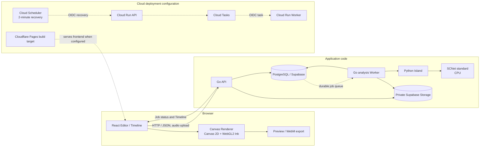

# AI Audio-Reactive Visual Compiler (ARVC)

音源を解析してFeature Timelineを作り、その時系列データに反応するビジュアルを編集・プレビュー・動画出力するWebアプリです。FrontendのEditorとRenderer、Go API、Pythonによる音源解析を分け、解析データと描画設定を別々に扱います。

> **実装状況:** READMEはGitHub `main`のコードと公開リポジトリ内の資料を説明します。開発者は本番β版の実デプロイ情報を手動で独立照合し、受入確認を完了しています。アプリケーションとクラウド設定は、機能・権限・運用を分けた構成で管理しています。

## Features

### 音源解析

- WAV/MP3の読み込みと解析区間の指定。解析APIでは44.1 kHz stereo PCM16 WAVに変換し、最大60秒・リクエスト本文16 MiBまでを受け付けます。
- Python IslandでSCNet standardをCPU実行し、drums / bass / vocals / otherのStemを使ってFeature TimelineとMusic Summaryを生成します。APIの標準separatorはSCNetで、Demucsは開発用の比較・評価経路として分離しています。
- TimelineにはEnvelope、Kick/Snare推定イベント、Drum Energy、signed PCM peak、Spectrumなどを含められます。Kick/Snareはdrums stemのtransientから得るイベント推定値です。
- ローカル解析では音源を外部送信せず、一時ファイルは解析処理後に削除します。クラウド向けにはprivate Supabase Storage経路を用意しています。

### Editor・出力

- Timelineを確認し、背景画像、矩形・多角形Region、画像レイヤー、Effect、音響Binding、色・Gradientを編集できます。Regionは正規化座標で保持され、Effectごとに指定Regionでclipされます。
- Pulse / Transform、Waveform、Spectrum、Radial、Particle、Ripple / Shockwave、Ink系などの定義済みEffectをCanvasベースで描画します。Ink系はWebGL2とCanvas 2D fallbackの描画経路を備えます。
- 同じ`renderEditorFrame`経路をPreviewと動画出力で使います。ローカル音源をPreviewに同期し、Canvas captureとMediaRecorderによるWebM出力を行えます。出力はブラウザ内のリアルタイム録画経路です。
- `.arvproj` v1のportable project fileでBlueprint、Timeline、画像、任意の音源を保存・復元できます。復元時にはSHA-256でファイル整合性を検査します。
- Cloud Project API / Asset APIとSupabase Storage用のコード・DB migrationsがあります。β版のEditorはローカルProjectを中心に構成し、Cloud Project操作UIは独立したHosted保存機能として分離しています。API契約と再有効化条件は保持し、認証・保存・Asset lifecycleの運用境界を整えてからUIを統合する設計です。

### 認証・利用制御

- Supabase Authによるログインと招待受け入れ、初回パスワード設定を実装しています。一般ユーザー向けsignupは無効です。
- 音声解析にはDB entitlement、期限、quota、rate limit、同時実行枠、kill switchがあります。解析上限や利用可否はサービス設定にも依存します。
- Blueprint生成APIは検証済みBlueprintデータを返し、Budget制御と組み合わせられます。β版のFrontendはTimelineと定義済みEffectを使うEditor体験を中心にし、生成UIは独立した連携機能として分離しています。

## Tech Stack

| 領域 | 技術 | 用途 |
|---|---|---|
| Frontend | React 19.3.1, TypeScript 6.0.3, Vite 8.3.5 | Editor、Timeline、Preview、Projectファイル、動画出力 |
| Rendering | Canvas 2D, WebGL2 | 定義済みEffect描画。Ink系WebGL2にはCanvas fallbackあり |
| API | Go 1.27, Echo v5.4.2, pgx v5.12.0 | HTTP API、認証、解析Job、Project/Asset経路。Blueprint生成はGo `net/http`からOpenAI Responses APIを呼ぶserver-side adapterを実装 |
| Audio analysis | Python 3.14, NumPy 2.3.4, PyTorch 2.14.1 CPU | 音源変換、Stem分離、特徴量とTimeline生成 |
| Separation | SCNet standard | APIの標準Stem分離モデル。重みは別途配置しSHA-256を検査 |
| Database / Auth / Storage | Supabase Auth, PostgreSQL, Supabase Storage | ユーザー認証、quota/job/Projectデータ、音源・Asset保存 |
| Cloud configuration | Cloud Run, Cloud Tasks, Cloud Scheduler | API/Worker、Job配送、2分間隔の復旧Scheduler template、保護付きrelease workflow |
| Frontend hosting | Cloudflare Pages向けbuild設定 | SPA fallback・headers等のbuild検査。本番β版の実デプロイ情報は開発者が手動で独立照合 |
| CI | GitHub Actions | Frontend品質確認、Go race/vet、migration guardとDB検証 |
| Testing | Vitest, Go test, pytest | Frontend、API、解析ロジックの回帰検証 |

依存の正確な版は[`frontend/package.json`](frontend/package.json)、[`api/go.mod`](api/go.mod)、[`python-island/pyproject.toml`](python-island/pyproject.toml)を参照してください。Pythonの固定依存と推移依存は[`python-island/uv.lock`](python-island/uv.lock)にあります。

## Architecture

以下は、コード上の責務分離と、Cloud用templateに記述された接続関係です。破線はtemplate上の関係を示します。



FrontendではBlueprint（Scene / Region / Effect / Binding）とFeature Timelineを別データとして保持します。Rendererはそれらと時刻から描画命令を評価し、定義済みEffectの描画操作をCanvasへ出力します。

## Processing Flow

1. ユーザーが音源を選び、解析区間を指定します。
2. Go APIが認証と入力制約を確認して解析Jobを受け付けます。ローカル構成ではDB-backed queueとWorkerが状態を管理します。
3. WorkerがJobをclaimし、Python Islandを呼び出します。Pythonは音声を標準形式へ変換し、SCNet standardでStemを分離してTimeline / Summaryを生成します。
4. Workerが結果とJob状態をPostgreSQLへ記録します。Storage経路では音源をprivate bucketへ置き、DB上のintent/outboxとcleanup処理を使います。
5. FrontendはJob状態を取得し、TimelineをEditorへ反映します。Timelineは解析結果、Blueprintは編集可能な演出設定を保持します。
6. EditorのBindingがTimelineの連続値・イベントをEffectへ対応づけます。RendererはBlueprint、Timeline、再生時刻からフレームを評価します。
7. Previewは選択音源と再生位置を同期します。WebM出力も同じEditor frame rendererを利用します。

Cloud構成ではCloud TasksへJob IDを配送し、Cloud Run WorkerがOIDC taskを処理します。transactional outboxとDBのJob claim / attempt fencingが配送再試行と実行権を管理します。Cloud Schedulerはdispatch復旧endpointを2分間隔で呼び出す設定templateを持ち、保護付きmanual release workflowには環境承認とimage digest指定を組み込んでいます。Cloud Tasks transportはrelease時に明示flagで選択するopt-in経路です。Productionの実デプロイ情報とβ版受入は開発者が手動で照合・確認しています。

## Engineering Decisions

| 課題 | 実装上の判断 | 確認できる効果と制約 |
|---|---|---|
| Web APIと音源解析で異なる実行環境が必要 | GoがAPI / 認証 / Job lifecycleを担当し、Python Island CLIを子プロセスとして起動。Pythonは音源分離・特徴抽出を担当 | Web APIはGoのHTTP処理系、音源モデルはPyTorchを使うPython環境に分け、request context、一時作業領域、出力validationを連携境界にしています。 |
| 長い解析を受付APIと同じ処理に閉じ込めない | 同期handlerを残しながら、DB-backed durable Job、Worker、status / cancel APIを追加 | PostgreSQLがJob状態とclaim権限の正本です。queued中はquotaをreserveせず、Worker claim時に解析・quota lifecycleを開始します。[Queue設計](docs/reports/2026-11-05-step7k-50b-audio-analysis-job-queue.md)、[実装と隔離検証](docs/reports/2026-11-05-step7k-50c-durable-queue-hosted-cicd.md) |
| 重複配送やWorker停止後の再claim | DB lease / attempt fencing / transactional outbox / Job単位quota reservationを使います。Cloud TasksはJob ID配送のtransportとして接続 | 古いattemptからのJob更新とquota精算をfenceし、同一Jobの再試行ではquota reservationを再利用します。DB commit前の停止時は解析を再実行するat-least-once実行モデルを採り、最終状態を一貫して収束させます。[Quota・recovery検証](docs/reports/2026-11-05-step7k-50d-queue-recovery-parallel-benchmark.md)、[Cloud Tasks Worker](docs/reports/2026-11-05-step7k-50e-cloudtasks-worker.md) |
| 音源・解析結果と描画設定を独立に編集する | Feature TimelineとBlueprintを分け、Bindingで両者を接続 | 解析結果をEffect個別パラメータから独立して保持。Project/Cloud API payloadはversion付きデータとして検証。[解析からEditorへの接続](docs/reports/2026-11-01-step7k-12-analysis-to-editor-flow.md) |
| AI出力を安全にEditorへ取り込む | BlueprintデータをBackend / Frontend validatorで検査し、Rendererは定義済みEffectを扱う | EditorのEffect contractを保ち、AI連携を独立したserver-side adapterとして構成しています。[Provider移行・契約](docs/reports/2026-11-01-openai-gpt-6-luna-provider-migration.md) |
| 多様な描画と動画出力の整合 | PreviewとWebMが共通の`renderEditorFrame`を使う | 同じ描画経路をブラウザ内PreviewとMediaRecorder exportで共有し、Editorの表示と出力の実装重複を抑えます。[Editor連携](docs/reports/2026-11-01-step7k-12-analysis-to-editor-flow.md)、[WebM/MP4 export調査](docs/reports/2026-11-02-step7k-30-webm-mp4-export.md) |
| CPU実行と解析資源の制約を管理する | CPU-only PyTorch、60秒/16MiB入力上限、同期APIの既定600秒timeout、非同期Workerの12分処理期限、quota・rate / concurrency制御を実装 | DB queueは最大2件のJob claimを管理し、attempt fencingとquota settlementを隔離PostgreSQLで検証しました。実SCNet同時推論の容量測定は、開発環境のRAM余力を踏まえて本工程の対象から分けています。[GCP案比較・費用条件](docs/reports/2026-11-02-step7k-32-gcp-architecture-cost-validation.md)、[Job復旧と並列測定](docs/reports/2026-11-05-step7k-50d-queue-recovery-parallel-benchmark.md)

### 音源分離モデルとCPU実測

Python Islandの既定separatorはSCNet standardです。Step 7k-36では、API / Timeline v1 / Feature Extractorの契約を保ったまま既定モデルをSCNetへ移し、Demucsを開発用optional extraへ分離しました。CPU比較は採用判断の参考値として記録し、単一の速度指標をモデル優位性とは扱っていません。60秒の同一音源・Linux CPU・2 threadsによる3プロセス測定では、warm wall中央値はDemucs 47.95秒 / SCNet 52.18秒、peak RSS中央値は1,417.75 / 2,149.09 MiBでした。Python / NumPy / PyTorch版と推論wrapperが異なるため、数値は当時の実行環境における比較です。Kick/SnareはTimelineの推定イベントとして提供し、注釈データを用いた精度評価は将来の評価工程に分けています。[比較評価](docs/reports/2026-11-02-step7k-34-scnet-demucs-final-evaluation.md)、[同一ホストCPU/RSS測定](docs/reports/2026-11-02-step7k-35-scnet-adoption-validation.md)、[既定separator統合](docs/reports/2026-11-02-step7k-36-scnet-production-integration.md)。

SCNet checkpointはサイズとSHA-256を固定し、`weights_only=True`、strict state loadingを使います。モデル重みをアプリコードから分離し、配置時にhashを検査して、モデル取得と推論実行の境界を明確にしています。PoCでは公式PyTorchを比較基準にし、checkpointの来歴とlicenseを追跡できる方式を選びました。[PoC方式とライセンス調査](docs/reports/2026-11-02-step7k-33-scnet-poc-evaluation.md)。

### Cloud Run案と費用制約

Cloud Run案では、Go→Python子プロセス方式を保つ同一image/service、APIと解析serviceの分離、Cloud Run Jobsを比較しました。非同期解析の採用後はDB-backed queueを状態とclaimの正本とし、Cloud Tasksを配送transportとして分離しました。Scheduler recovery設定、private Worker、OIDC task、手動release workflowを組み合わせ、認証・データ・実行環境の境界を明確にしています。[GCP構成比較](docs/reports/2026-11-02-step7k-32-gcp-architecture-cost-validation.md)、[Cloud release readiness](docs/reports/2026-11-05-step7k-51-cloud-release-readiness.md)。

## Reliability and Security

- Supabase JWTのissuer / audience / expiry検証をGo APIで行い、DB側ではRLS・権限境界とowner scopeを設定しています。
- 解析Jobは状態遷移、lease、attempt fencing、idempotency key、quota reservation/settlementを持ちます。quota reservationはJobに結びつけ、一つのJobで二重精算されないようDB制約・RPCで管理します。DB確定前にWorkerが停止した場合は再推論で結果を再生成する構成とし、Job状態とquota処理をattempt単位で安全に収束させます。
- 解析APIは最大60秒の区間と16 MiBの入力を受け付けます。同期解析handlerの既定期限は600秒、Cloud Tasks Worker handlerの処理期限は12分、Cloud Run Worker templateのrequest timeoutは780秒、Job leaseは15分です。API・Worker・queue leaseに異なる時間枠を設定し、処理完了と障害回復の責務を分けています。
- Cloud Tasks transportはrelease templateのopt-in項目です。Cloud Run private WorkerはOIDC taskを受け付け、Cloud Schedulerからdispatch復旧endpointを2分間隔で呼ぶ設定templateがあります。本番β版の実デプロイ情報は開発者が独立照合し、β版受入確認を完了しています。
- Supabase Storageはprivate object、owner-scoped read、service-side write、upload intent / cleanup outboxを使う設計です。DB上限予約とcleanup outboxを組み合わせ、Project/Assetと音源の保存領域を分けて管理します。
- `AUDIO_ANALYSIS_ENABLED`等の停止flagとDB controlがあります。停止時の既存Job・Storageデータの扱いはCloud Run手順書を参照してください。

詳細：[Cloud Run / Cloud Tasks運用テンプレート](deploy/cloud-run/README.md)、[API contracts](docs/API_CONTRACTS.md)、[Environment guide](docs/ENVIRONMENT_GUIDE.md)。

## Testing and Quality

現在のGitHub Actionsで実行する主なチェックは次のとおりです。

- Frontend: TypeScript typecheck、ESLint、Vitest、production buildとPages build検査。
- Go: `go test -race ./...`、`go vet ./...`。
- Database: forward-only migration guard、Hosted migration manifest、fresh local Supabase上でのmigration適用・sentinel保持・RLS/ACL/SQL回帰確認・`supabase db lint`。

GitHub ActionsはFrontend、Go、Databaseの品質確認を自動化し、詳細は[GitHub Actions](https://github.com/JunA-priv/audio-reactive-visual-compiler/actions)で確認できます。Python音声解析にはaudio / feature / SCNet関連のpytest suiteを備えています。


## Implementation Evidence

READMEの主要な設計説明から実装・検証根拠へ移動できるよう、関連する公開repo内資料をリンクしています。詳細な提案・検討結果は確定仕様と区別してください。

- [音源解析からEditorへの接続](docs/reports/2026-11-01-step7k-12-analysis-to-editor-flow.md)：crop WAV、Timeline/Summary、Blueprint validation、Preview audio clockの境界。
- [Visual EditorのResponsive UI](docs/reports/2026-11-04-step7k-48-responsive-visual-editor.md)：Editorの画面順、狭幅レイアウト、操作パネル配置。
- [Project / AssetをUIから隠した理由と再有効化条件](docs/reports/2026-11-02-step7k-19-cloud-ui-defer.md)、[再有効化メモ](docs/CLOUD_PROJECT_REACTIVATION.md)。
- [Hosted migration readiness](docs/reports/2026-11-05-step7k-57b-hosted-migration-blockers.md)：DB容量予約、migration manifest、isolated restoreによる運用準備。
- [招待URLと初回パスワードのFrontend設計](docs/reports/2026-11-05-step7k-58f-2-invite-fragment-confirmation.md)：fragment token、explicit user action、URL scrub、signup disabled。

## Deployment and Local Setup

GitHubリポジトリは[JunA-priv/audio-reactive-visual-compiler](https://github.com/JunA-priv/audio-reactive-visual-compiler)です。開発者による手動の独立照合で、本番β版の実デプロイ情報と受入確認が完了しています。具体的な運用設定は、ユーザー情報や環境固有値を公開せず、機能・アーキテクチャ・技術判断を中心に説明しています。

Windows 11 + WSL2での開発環境profile、依存導入、起動・停止方法は[Environment Guide](docs/ENVIRONMENT_GUIDE.md)と[Environment Setup](docs/ENVIRONMENT_SETUP.md)を参照してください。

Frontend単独で依存を導入して確認する場合：

```bash
cd frontend
npm ci
npm run typecheck
npm run lint
npm test
npm run build
```

標準SCNet checkpointはアプリケーションコードと分離して管理し、SHA-256を照合してPython Islandへ配置します。配置手順とPython環境の準備は[Python Island README](python-island/README.md)を参照してください。API / DB / Authを含む構成はEnvironment Guideのprofile launcherを利用してください。

## Scope and Evaluation

- 解析APIは44.1 kHz stereo PCM16 WAVを受け付け、区間は最大60秒、multipart request全体は最大16 MiBです。長い音源は区間を分けて解析します。
- 音源解析はCPU実行です。Step 7k-35のCPU/RSS benchmarkは60秒のdemo4 crop、同一Linux host、2 threads、各model 3 processで実施しました。測定結果は各環境のruntime/library versionsと推論wrapperを含む実行条件とともに記録しています。DB queueは最大2件をclaimでき、実SCNetを使う同時推論のresource sizingは開発環境のRAM予算とは分けて扱っています。
- Kick / Snareはdrums stemから抽出する推定イベントで、音楽要素をEffectへ結びつけるTimeline controlとして利用します。注釈付きデータによる精度評価は、評価用データセットを用意する工程としてFuture Developmentに分けています。
- `.arvproj` v1はJSONベースのportable project formatで、復元時にSHA-256整合性を検査します。暗号化はプロジェクト形式の追加要件として現在のローカル保存仕様から分離しています。
- PreviewとWebM出力は共通の`renderEditorFrame`を使い、Browser MediaRecorderのリアルタイム記録経路で映像化します。Canvas 2D/WebGL2 Ink fallbackを用意し、frame cadenceとcodecはブラウザ側の記録条件に沿って処理します。
- 開発者は本番β版の実デプロイ情報を手動で独立照合し、総合受入を完了しています。アプリケーションではquota、rate limit、同時実行枠、kill switchを運用制御として備え、クラウドrelease templateはresource / IAM / recovery設定を明示します。
- β版のEditorはTimelineと定義済みEffectの編集を中心に構成しています。Blueprint生成UI、AI素材生成、一般signup、課金機能は現在の製品スコープから分け、独立したUX・権限・運用設計を必要とする機能として扱います。

## Future Development

以下は現行実装を広げる開発候補です。優先順位は利用状況と開発計画に沿って決定します。

- AI Blueprint生成をEditor UIへ統合するユーザー操作と既存Effect contractの整理。現在のβ版はTimeline中心のEditor体験を優先し、生成機能を独立した連携として扱っています。
- Typography / Glyph / Text系、画像distortionなど追加Effectの検討。既存Canvas/WebGL Rendererと性能・seek再現性への影響を評価する。
- Kick / Snare等の推定品質を、権利確認済み音源と注釈データを用いた評価で改善する。注釈データを使う評価工程を、機能実装と分けて設計しています。
- Timeline特徴量とKick / Snare推定を、複数の楽曲ジャンルと演奏条件に広げて評価する。
- Cloud Projectと画像・素材編集を、既存API契約、権限境界、storage lifecycleに沿ってEditor UIへ広げる。
- Cloud Run / Tasks / Scheduler、Hosted Supabase、Cloudflare Pagesの運用情報をrelease documentationと同期し、負荷・復旧の運用手順を継続的に整備する。

Effect候補の詳細は[Visual Effect Roadmap](docs/VISUAL_EFFECT_ROADMAP.md)を参照してください。RoadmapはEffect追加を検討する際の設計候補をまとめています。

