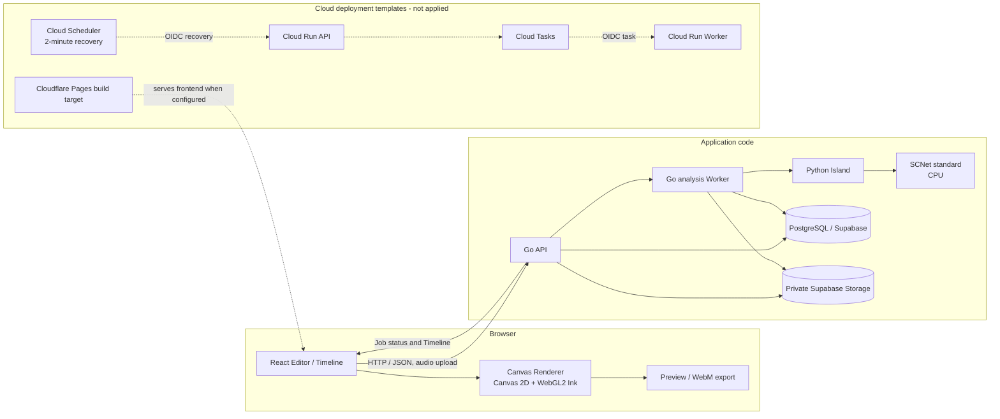

# AI Audio-Reactive Visual Compiler (ARVC)

音源を解析してFeature Timelineを作り、その時系列データに反応するビジュアルを編集・プレビュー・動画出力するWebアプリです。FrontendのEditorとRenderer、Go API、Pythonによる音源解析を分け、解析データと描画設定を別々に扱います。

> **実装状況:** ローカル開発環境を中心に実装・検証しています。Cloud Run、Cloud Tasks、Cloud Scheduler、Hosted Supabase、Cloudflare PagesのProduction環境への適用は確認されていません。クラウド用の設定ファイルやWorkflowは、稼働中のProduction環境を示すものではありません。

## Features

### 音源解析

- WAV/MP3の読み込みと解析区間の指定。解析APIでは44.1 kHz stereo PCM16 WAVに変換し、最大60秒・リクエスト本文16 MiBまでを受け付けます。
- Python IslandでSCNet standardをCPU実行し、drums / bass / vocals / otherのStemを使ってFeature TimelineとMusic Summaryを生成します。標準処理はSCNetです。Demucsは開発用の比較・評価経路で、API標準エンジンではありません。
- TimelineにはEnvelope、Kick/Snare推定イベント、Drum Energy、signed PCM peak、Spectrumなどを含められます。Snareはdrums stemのtransient推定で、厳密なstem分離を表すものではありません。
- ローカル解析では音源を外部送信せず、一時ファイルは解析処理後に削除します。クラウド向けStorage経路は実装されていますが、Hosted環境での運用は未確認です。

### Editor・出力

- Timelineを確認し、背景画像、矩形・多角形Region、画像レイヤー、Effect、音響Binding、色・Gradientを編集できます。
- Pulse / Transform、Waveform、Spectrum、Radial、Particle、Ripple / Shockwave、Ink系などの定義済みEffectをCanvasベースで描画します。Ink系はWebGL2経路を使い、利用できない場合はCanvas 2D描画へfallbackします。
- 同じ`renderEditorFrame`経路をPreviewと動画出力で使います。ローカル音源をPreviewに同期し、Canvas captureとMediaRecorderによるWebM出力を行えます。
- `.arvproj` v1でBlueprint、Timeline、画像、任意の音源を含むProjectを保存・復元できます。ファイルは平文JSONで、暗号化Blueprint形式は実装されていません。
- Cloud Project API / Asset APIとSupabase Storage用のコード・DB migrationsがあります。現行のCloud Run templateではProject routesは無効で、Hosted Supabase・実クラウド上の保存機能は確認されていません。

### 認証・利用制御

- Supabase Authによるログインと招待受け入れ、初回パスワード設定を実装しています。一般ユーザー向けsignupは無効です。
- 音声解析にはDB entitlement、期限、quota、rate limit、同時実行枠、kill switchがあります。解析上限や利用可否はサービス設定にも依存します。
- AIによるEffect生成のAPI / Budget実装はありますが、最新Frontendでは生成UIを非表示にしています。現在利用できるEditor機能としては案内しません。

## Tech Stack

| 領域 | 技術 | 用途 |
|---|---|---|
| Frontend | React 19.3.1, TypeScript 6.0.3, Vite 8.3.5 | Editor、Timeline、Preview、Projectファイル、動画出力 |
| Rendering | Canvas 2D, WebGL2 | 定義済みEffect描画。Ink系WebGL2にはCanvas fallbackあり |
| API | Go 1.27, Echo v5.4.2, pgx v5.12.0 | HTTP API、認証、解析Job、Project/Asset経路 |
| Audio analysis | Python 3.14, NumPy 2.3.4, PyTorch 2.14.1 CPU | 音源変換、Stem分離、特徴量とTimeline生成 |
| Separation | SCNet standard | APIの標準Stem分離モデル。重みは別途配置しSHA-256を検査 |
| Database / Auth / Storage | Supabase Auth, PostgreSQL, Supabase Storage | ユーザー認証、quota/job/Projectデータ、音源・Asset保存 |
| Cloud templates | Cloud Run, Cloud Tasks, Cloud Scheduler | API/Worker、Job配送、復旧Schedulerの未適用テンプレート |
| Frontend hosting | Cloudflare Pages向けbuild設定 | SPA fallback・headers等のbuild検査。Production公開先は未確認 |
| CI | GitHub Actions | Frontend品質確認、Go race/vet、migration guardとDB検証 |
| Testing | Vitest, Go test, pytest | Frontend、API、解析ロジックの回帰検証 |

依存の正確な版は[`frontend/package.json`](frontend/package.json)、[`api/go.mod`](api/go.mod)、[`python-island/pyproject.toml`](python-island/pyproject.toml)を参照してください。Pythonの固定依存と推移依存は[`python-island/uv.lock`](python-island/uv.lock)にあります。

## Architecture

以下は、コード上の責務分離とクラウド用テンプレートの接続関係です。破線部分は設定テンプレートであり、Productionへのデプロイ済みを意味しません。



FrontendではBlueprint（Scene / Region / Effect / Binding）とFeature Timelineを別データとして保持します。Rendererはそれらと時刻から描画命令を評価し、Canvasへの描画を行います。AIが生成した任意のJavaScript・Python・GLSLを実行する仕組みはありません。

## Processing Flow

1. ユーザーが音源を選び、解析区間を指定します。
2. Go APIが認証と入力制約を確認して解析Jobを受け付けます。ローカル構成ではDB-backed queueとWorkerが状態を管理します。
3. WorkerがJobをclaimし、Python Islandを呼び出します。Pythonは音声を標準形式へ変換し、SCNet standardでStemを分離してTimeline / Summaryを生成します。
4. Workerが結果とJob状態をPostgreSQLへ記録します。Storage経路では音源をprivate bucketへ置き、DB上のintent/outboxとcleanup処理を使います。
5. FrontendはJob状態を取得し、TimelineをEditorへ反映します。Timelineは解析結果、Blueprintは編集可能な演出設定を保持します。
6. EditorのBindingがTimelineの連続値・イベントをEffectへ対応づけます。RendererはBlueprint、Timeline、再生時刻からフレームを評価します。
7. Previewは選択音源と再生位置を同期します。WebM出力も同じEditor frame rendererを利用します。

クラウド構成ではCloud TasksにJob IDを配送し、Cloud Run WorkerがOIDC taskを処理するadapterとtransactional outboxがあります。DBのJob claimとattempt fencingが実行権を管理し、Cloud Schedulerはdispatch復旧endpointを定期呼出しするテンプレートです。これらのGCPリソースは作成・適用されていません。

## Engineering Decisions

| 課題 | 実装上の判断 | 確認できる効果と制約 |
|---|---|---|
| Web APIと音源解析で異なる実行環境が必要 | Go APIからPython Islandを起動し、API / queueと数値解析を別プロセスに分離 | Python解析をGo handler経由で検証可能。プロセス起動・一時ファイル・timeoutの運用が必要 |
| 解析がHTTP request時間を占有する | DB Job、Worker、Job status APIを用いる非同期経路を実装 | enqueue後に状態を取得でき、cancel/retry/recoveryをJob状態として扱える。Cloud Tasks配信は環境flagとGCP設定が必要 |
| 重複配送やWorker停止後の再claim | Job ID配送、DB lease、attempt generation fencing、transactional outbox、Job単位のquota reservation | 古いattemptの完了を拒み、再配送・lease recovery経路を隔離DBで検証。exactly-once推論を保証するものではない |
| 音源・解析結果と描画設定を独立に編集する | Feature TimelineとBlueprintを分け、Bindingで両者を接続 | 解析結果をEffect個別パラメータから独立して保持。Project/Cloud API payloadはversion付きデータとして検証 |
| AI出力を安全にEditorへ取り込む | AIはBlueprintデータを返し、Backend / Frontend validatorでschema・値を検査。任意コードは実行しない | Rendererが扱うEffect種類・パラメータは定義済み。AI生成UIは現在非表示 |
| 多様な描画と動画出力の整合 | PreviewとWebMが共通の`renderEditorFrame`を使う | 描画ロジックの共有をコードで確認。実ブラウザ・各codec間の画素一致やFPSは未保証 |
| 分析コスト・入力資源を制御する | CPU-only PyTorch、60秒/16MiB入力上限、timeout、quota・同時実行制御、Storage容量制限を実装 | 制御値は存在するが、Cloud上の請求額や月額上限を保証するものではない。実SCNet同時負荷とCloud費用は未測定 |

SCNetを選定した当時の比較・判断理由は現行の公開資料から確認できないため、READMEでは技術的な選定動機を推定していません。CPU実行は依存設定とruntime実装で確認できる構成上の事実です。

## Reliability and Security

- Supabase JWTのissuer / audience / expiry検証をGo APIで行い、DB側ではRLS・権限境界とowner scopeを設定しています。
- 解析Jobは状態遷移、lease、attempt fencing、idempotency key、quota reservation/settlementを持ちます。quota reservationはJobに結びつけ、一つのJobで二重精算されないようDB制約・RPCで管理します。
- 解析APIの同期・非同期経路に入力上限、最大60秒の解析区間、最大600秒の解析timeoutと実行枠制御があります。設定値は絶対的な復旧・可用性保証ではありません。
- Cloud Tasksは既定disabledで、明示的な有効化なしには起動しません。Cloud Runはprivate WorkerとOIDCを想定したtemplateです。Scheduler recovery jobも未作成です。
- Supabase Storageはprivate object、owner-scoped read、service-side write、upload intent / cleanup outboxを使う設計です。Hosted policyと実障害復旧は未検証です。
- `AUDIO_ANALYSIS_ENABLED`等の停止flagとDB controlがあります。停止時の既存Job・Storageデータの扱いはCloud Run手順書を参照してください。

詳細：[Cloud Run / Cloud Tasks運用テンプレート](deploy/cloud-run/README.md)、[API contracts](docs/API_CONTRACTS.md)、[Environment guide](docs/ENVIRONMENT_GUIDE.md)。

## Testing and Quality

現在のGitHub Actionsで実行する主なチェックは次のとおりです。

- Frontend: TypeScript typecheck、ESLint、Vitest、production buildとPages build検査。
- Go: `go test -race ./...`、`go vet ./...`。
- Database: forward-only migration guard、Hosted migration manifest、fresh local Supabase上でのmigration適用・sentinel保持・RLS/ACL/SQL回帰確認・`supabase db lint`。
- Python: audio / feature / SCNet関連のpytest suiteがあります。現在のGitHub ActionsにはPythonテストjobは定義されていません。Demucs統合テストは事前配置された開発用checkpointが必要です。

最新のCI状態は[GitHub Actions](https://github.com/JunA-priv/audio-reactive-visual-compiler/actions)で確認してください。ここでは過去の実行結果を現在のPASSとして扱いません。SCNet/GPU/browserを必要とする一部の実画面・描画評価は自動CIの範囲外です。

## Deployment and Local Setup

Production URLはGitHub repository metadataおよび現在のdeployment設定から確認できていません。GitHubリポジトリは[JunA-priv/audio-reactive-visual-compiler](https://github.com/JunA-priv/audio-reactive-visual-compiler)です。Cloud Run、Cloud Tasks、Cloud Scheduler、Hosted Supabase、Cloudflare Pagesへの本番適用・公開状態は未確認です。

Windows 11 + WSL2での開発環境profile、依存導入、起動・停止方法は[Environment Guide](docs/ENVIRONMENT_GUIDE.md)と[Environment Setup](docs/ENVIRONMENT_SETUP.md)を参照してください。

Frontend単独で依存を導入して確認する場合：

```bash
cd frontend
npm ci
npm run typecheck
npm run lint
npm test
npm run build
```

標準SCNet checkpointはGitやpackageに含まれず、自動ダウンロードもしません。配置場所、SHA-256、Python環境の準備は[Python Island README](python-island/README.md)を参照してください。API / DB / Authを含む構成はEnvironment Guideのprofile launcherを利用してください。

## Limitations

- 解析APIは44.1 kHz stereo PCM16 WAVを受け付け、区間は最大60秒、multipart request全体は最大16 MiBです。長い音源は区間を分けて解析します。
- 音源解析はCPU実行です。大きな音源や同時推論時の待ち時間・メモリ・費用はProduction負荷で計測されていません。
- Kick / Snareは推定イベントです。注釈付きtruth setによる検出精度は確立していません。
- `.arvproj`は平文JSONです。復元時のSHA-256整合性検査はありますが、暗号化・機密保護を提供しません。
- WebGL2 Ink fallbackはありますが、実ブラウザの視覚品質、ブラウザ間の描画差、WebM codec互換性やFPSは一律検証されていません。
- Hosted SupabaseとGCPのresource / IAM / capacity / failure recovery / cost、Cloudflare Pagesの実公開先は未確認です。月額費用の上限は保証されません。
- AI Blueprint生成のBackend実装はありますが、Frontendの生成UIは非表示です。暗号化Blueprint、AI素材生成、一般signup、課金機能は利用可能な機能として提供していません。

## Future Development

以下は現行実装と区別した開発候補です。実施順・時期は確定していません。

- AI Blueprint生成をEditor UIへ再統合する条件・操作・安全性の整理。
- Typography / Glyph / Text系、画像distortionなど追加Effectの検討。既存Canvas/WebGL Rendererと性能・seek再現性への影響を評価する。
- Kick / Snare等の推定品質を、確認済み注釈と評価データで改善する。現状はaccuracyを主張できる正解データがありません。
- Timelineで利用する音楽特徴量と解析品質の改善。追加特徴量は解析方式・schema・過去Project互換性を合わせて検討する。
- Cloud Projectと画像・素材編集の拡張。現行Cloud routesが無効のtemplate、およびHosted DB/Storage運用条件を先に確認する。
- Hosted Supabase、Cloud Run / Tasks / Scheduler、Cloudflare Pagesの実環境適用と、ブラウザ・負荷・容量・費用の受け入れ検証。

Effect候補の詳細は[Visual Effect Roadmap](docs/VISUAL_EFFECT_ROADMAP.md)を参照してください。この資料も提案を含み、記載候補が実装予定として確定したことを意味しません。
