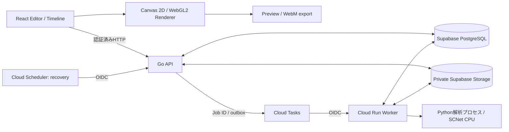

# AI Audio-Reactive Visual Compiler (ARVC)

音源の特徴を解析し、楽曲に連動するビジュアルを編集・プレビュー・動画出力できるWebアプリケーションです。音源分離・特徴量抽出から得た **Feature Timeline** と、映像の構成・効果を定義する **Blueprint** を分離し、再生時刻に応じて描画します。

**[アプリを試す（招待制β版）](https://audio-reactive-visual-compiler.pages.dev/app)** · **[GitHubリポジトリ](https://github.com/JunA-priv/audio-reactive-visual-compiler)**

ReactのEditor、Go API／非同期Worker、Pythonの音源解析、Canvas/WebGLのRendererを組み合わせています。以下では、機能、システム構成、設計判断、検証方法を、実装と開発記録に基づいて説明します。

## Features

### 音源解析

- WAV/MP3の読み込みと解析区間の指定。解析APIでは44.1 kHz stereo PCM16 WAVに変換し、最大60秒・リクエスト本文16 MiBまでを受け付けます。

- Pythonの解析処理でSCNet standardをCPU実行し、音源をdrums / bass / vocals / otherの4つのstemに分離します。各stemから特徴量を抽出し、時系列データ（Feature Timeline）とMusic Summaryを生成します。Demucsはモデル比較・評価用の経路として分離しています。

- Timelineには音量変化（Envelope）、Kick / Snareの推定イベント、Drum Energy、PCM peak、Spectrumなどを保持します。Kick / Snareはdrums stemの過渡成分から推定するもので、独立した音源として分離するものではありません。

- ローカル解析では音源を外部送信せず、一時ファイルは解析処理後に削除します。クラウド解析ではprivate Supabase Storageを利用し、処理後のファイル削除を管理します。

### Editor・出力

- Timelineを確認し、背景画像、矩形・多角形Region、画像レイヤー、Effect、音響Binding、色・Gradientを編集できます。Regionは正規化座標で保持され、Effectごとに指定Regionでclipされます。

- Pulse / Transform、Waveform、Spectrum、Radial、Particle、Ripple / Shockwave、Ink系などの定義済みEffectをCanvasベースで描画します。Ink系はWebGL2とCanvas 2D fallbackの描画経路を備えます。

- 同じ`renderEditorFrame`経路をPreviewと動画出力で使います。ローカル音源をPreviewに同期し、Canvas captureとMediaRecorderによるWebM出力を行えます。出力はブラウザ内のリアルタイム録画経路です。

- `.arvproj` v1のportable project fileでBlueprint、Timeline、画像、任意の音源を保存・復元できます。復元時にはSHA-256でファイル整合性を検査します。

- プロジェクトのローカル保存・復元に対応しています。クラウド保存向けのProject / Asset APIも実装していますが、現在のβ版ではEditorから操作するUIを公開していません。

### 認証・利用制御

- Supabase Authによるログインと招待受け入れ、初回パスワード設定を実装しています。一般ユーザー向けsignupは無効です。

- 音声解析の利用資格（entitlement）、実行期限、利用回数（quota）、リクエスト頻度、同時実行数を制御します。運用側から解析受付を停止する仕組みも備えています。

- AIによるBlueprint生成のAPI実装を保持しつつ、β版ではTimelineと定義済みEffectによる編集機能を公開しています。

## Tech Stack

| 領域 | 技術 | 用途 |
|---|---|---|
| Frontend | React 19.3.1, TypeScript 6.0.3, Vite 8.3.5 | Editor、Timeline、Preview、Projectファイル、動画出力 |
| Rendering | Canvas 2D, WebGL2 | 定義済みEffect描画。Ink系WebGL2にはCanvas fallbackあり |
| API | Go 1.27, Echo v5.4.2, pgx v5.12.0 | HTTP API、認証、解析Job、Project/Asset経路。Blueprint生成はGo `net/http`からOpenAI Responses APIを呼ぶサーバー側の連携処理を実装 |
| Audio analysis | Python 3.14, NumPy 2.3.4, PyTorch 2.14.1 CPU | 音源変換、Stem分離、特徴量とTimeline生成 |
| Separation | SCNet standard | APIの標準Stem分離モデル。重みは別途配置しSHA-256を検査 |
| Database / Auth / Storage | Supabase Auth, PostgreSQL, Supabase Storage | ユーザー認証、quota/job/Projectデータ、音源・Asset保存 |
| Cloud configuration | Cloud Run, Cloud Tasks, Cloud Scheduler | API/Worker、Job配送、2分間隔の復旧処理 |
| Frontend hosting | Cloudflare Pages | React SPAの配信、buildと公開ワークフロー |
| CI | GitHub Actions | Frontend品質確認、Go race/vet、migration guardとDB検証 |
| Testing | Vitest, Go test, pytest | Frontend、API、解析ロジックの回帰検証 |

依存の正確な版は[`frontend/package.json`](frontend/package.json)、[`api/go.mod`](api/go.mod)、[`python-island/pyproject.toml`](python-island/pyproject.toml)を参照してください。Pythonの固定依存と推移依存は[`python-island/uv.lock`](python-island/uv.lock)にあります。

## Architecture

以下は、ブラウザー・API・Worker・永続化基盤・クラウド配送の主要な責務を示します。


FrontendではBlueprint（Scene / Region / Effect / Binding）とFeature Timelineを別データとして保持します。Rendererはそれらと時刻から描画命令を評価し、定義済みEffectの描画操作をCanvasへ出力します。

## Processing Flow

1. ユーザーが音源を選び、解析区間を指定します。

2. Go APIが認証と入力制約を確認して解析Jobを受け付けます。DBにJob状態を永続化し、Workerが実行権を取得します。

3. WorkerがJobの実行権を取得し、Python解析プロセスを呼び出します。Pythonは音声を標準形式へ変換し、SCNet standardでStemを分離してTimeline / Summaryを生成します。

4. Workerが結果とJob状態をPostgreSQLへ記録します。Storage経路では音源をprivate bucketへ置き、DB上のintent/outboxとcleanup処理を使います。

5. FrontendはJob状態を取得し、TimelineをEditorへ反映します。Timelineは解析結果、Blueprintは編集可能な演出設定を保持します。

6. EditorのBindingがTimelineの連続値・イベントをEffectへ対応づけます。RendererはBlueprint、Timeline、再生時刻からフレームを評価します。

7. Previewは選択音源と再生位置を同期します。WebM出力も同じEditor frame rendererを利用します。

本番β版ではCloud TasksがJob IDを配送し、非公開WorkerがOIDC認証付きタスクを処理します。トランザクショナルOutbox、DBによる実行権の管理、実行世代（attempt）による更新制御によって、配送の再試行と解析結果の確定を分離します。Cloud Schedulerは2分間隔で配送復旧を実行します。

## Engineering Decisions

| 課題 | 実装上の判断 | 確認できる効果と制約 |
|---|---|---|
| Web APIと音源解析で異なる実行環境が必要 | GoがAPI / 認証 / Jobの状態管理を担当し、Pythonの解析CLIを子プロセスとして起動。Pythonは音源分離・特徴抽出を担当 | Web APIはGoのHTTP処理系、音源モデルはPyTorchを使うPython環境に分け、リクエストのキャンセル、一時ファイル、出力データの検証を連携境界にしています。 |
| 長い解析を受付APIと同じ処理に閉じ込めない | 同期handlerを残しながら、PostgreSQLに永続化するJob、Worker、status / cancel APIを追加 | PostgreSQLがJob状態と実行権の正本です。queued中はquotaを確保せず、WorkerがJobの実行権を取得した時点で利用量を予約します。[Queue設計](docs/reports/2026-11-05-step7k-50b-audio-analysis-job-queue.md)、[実装と隔離検証](docs/reports/2026-11-05-step7k-50c-durable-queue-hosted-cicd.md) |
| 重複配送やWorker停止後の再実行 | DB lease / 実行世代（attempt）による更新制御 / トランザクショナルOutbox / Job単位quotaの予約を使います。Cloud TasksはJob IDの配送に利用 | 古い実行世代によるJob更新とquota精算を拒否し、同一Jobの再試行ではquotaの予約を再利用します。DBへの結果確定前にWorkerが停止した場合は再実行を許容し、Jobの最終状態と精算の整合性を維持します。[Quota・recovery検証](docs/reports/2026-11-05-step7k-50d-queue-recovery-parallel-benchmark.md)、[Cloud Tasks Worker](docs/reports/2026-11-05-step7k-50e-cloudtasks-worker.md) |
| 音源・解析結果と描画設定を独立に編集する | Feature TimelineとBlueprintを分け、Bindingで両者を接続 | 解析結果をEffect個別パラメータから独立して保持。Project / Cloud APIが扱うデータにはバージョンを付けて検証。[解析からEditorへの接続](docs/reports/2026-11-01-step7k-12-analysis-to-editor-flow.md) |
| AI出力を安全にEditorへ取り込む | BlueprintデータをBackend / Frontend validatorで検査し、Rendererは定義済みEffectを扱う | EditorのEffectのデータ契約を保ち、AI連携を独立したサーバー側の処理として構成しています。[Provider移行・契約](docs/reports/2026-11-01-openai-gpt-6-luna-provider-migration.md) |
| 多様な描画と動画出力の整合 | PreviewとWebMが共通の`renderEditorFrame`を使う | 同じ描画経路をブラウザ内PreviewとMediaRecorder exportで共有し、Editorの表示と出力の実装重複を抑えます。[Editor連携](docs/reports/2026-11-01-step7k-12-analysis-to-editor-flow.md)、[WebM/MP4 export調査](docs/reports/2026-11-02-step7k-30-webm-mp4-export.md) |
| CPU実行と解析資源の制約を管理する | CPU-only PyTorch、60秒/16MiB入力上限、受付起点300秒の非同期Job絶対期限、quota・rate / concurrency制御を実装 | DBの実行制御は同時に最大2件の解析を管理し、実行世代（attempt）による更新制御とquotaの精算を隔離PostgreSQLで検証しました。解析のリソース使用量はCPU・メモリの実測とクラウドのリソース上限を分けて管理しています。[GCP案比較・費用条件](docs/reports/2026-11-02-step7k-32-gcp-architecture-cost-validation.md)、[Job復旧と並列測定](docs/reports/2026-11-05-step7k-50d-queue-recovery-parallel-benchmark.md)

### 音源分離モデルとCPU実測

Python解析プロセスの既定separatorはSCNet standardです。API・Timeline・特徴量抽出の入出力契約を維持したまま標準モデルをSCNetに切り替え、Demucsは比較用途に分離しました。選定時にはCPUでの処理時間とメモリ使用量を測定し、モデルの利用条件や既存の解析データ契約との整合性も確認しました。60秒の同一音源をLinux CPU・2スレッドでそれぞれ3回測定した結果、処理時間の中央値はDemucsが47.95秒、SCNetが52.18秒、最大RSSの中央値はそれぞれ1,417.75 MiB、2,149.09 MiBでした。計測時のランタイム・推論処理の条件が異なるため、絶対的な性能比較ではなく、当時の構成選定に用いた実測値です。Kick/SnareはTimelineの推定イベントとして提供し、注釈データを用いた精度評価は今後の評価対象としています。[比較評価](docs/reports/2026-11-02-step7k-34-scnet-demucs-final-evaluation.md)、[同一ホストCPU/RSS測定](docs/reports/2026-11-02-step7k-35-scnet-adoption-validation.md)、[既定separator統合](docs/reports/2026-11-02-step7k-36-scnet-production-integration.md)。

SCNet checkpointはサイズとSHA-256を固定し、`weights_only=True`、strict state loadingを使います。モデル重みをアプリコードから分離し、配置時にhashを検査して、モデル取得と推論実行の境界を明確にしています。モデル検証では公式のPyTorch実装を参照し、checkpointの出所とライセンスを追跡できる形で管理しています。[PoC方式とライセンス調査](docs/reports/2026-11-02-step7k-33-scnet-poc-evaluation.md)。

### クラウド実行方式と費用制約

クラウド実行方式として、APIと解析処理を同一サービスで動かす構成、サービスを分離する構成、Cloud Run Jobsを比較しました。採用した構成では、PostgreSQLがJobの状態と実行権を管理し、Cloud TasksがJob IDを配送します。Workerを非公開サービスにし、OIDC認証付きタスク、Schedulerによる配送復旧、承認付きリリース手順を組み合わせています。[GCP構成比較](docs/reports/2026-11-02-step7k-32-gcp-architecture-cost-validation.md)、[クラウド公開前の検証](docs/reports/2026-11-05-step7k-51-cloud-release-readiness.md)。

## Reliability and Security

- Supabase JWTのissuer / audience / expiry検証をGo APIで行い、DB側ではRLS・権限境界とowner scopeを設定しています。

- 解析Jobは状態遷移、lease、実行世代（attempt）による更新制御、idempotency key、quotaの予約・精算を持ちます。quotaの予約はJobに結びつけ、一つのJobで二重精算されないようDB制約・RPCで管理します。DB確定前にWorkerが停止した場合は再推論で結果を再生成する構成とし、Job状態とquota処理をattempt単位で安全に収束させます。

- 本番β版の解析Jobには**受付時点から300秒の絶対期限**を設定しています。Queueでの待機時間も期限に含め、期限切れ時にはJob状態・quota精算・cleanupを整合させます。入力は最大60秒、解析用WAVのリクエスト上限は16 MiBです。

- Cloud Run 非公開WorkerはOIDC taskを受け付けます。Cloud Schedulerは2分間隔でdispatch復旧を呼び出します。API・Workerのインスタンス上限と同時実行数は別途設定しています。

- Supabase Storageはprivate object、owner-scoped read、service-side write、upload intent / cleanup outboxを使う設計です。DB上限予約とcleanup outboxを組み合わせ、Project/Assetと音源の保存領域を分けて管理します。

- `AUDIO_ANALYSIS_ENABLED`等の停止flagとDB controlがあります。停止時の既存Job・Storageデータの扱いはCloud Run手順書を参照してください。

詳細：[Cloud Run / Cloud Tasks運用設計](deploy/cloud-run/README.md)、[API contracts](docs/API_CONTRACTS.md)、[Environment guide](docs/ENVIRONMENT_GUIDE.md)。

## Testing and Quality

GitHub Actionsで実行する主なチェックは次のとおりです。

- Frontend: TypeScript typecheck、ESLint、Vitest、production buildとPages build検査。

- Go: `go test -race ./...`、`go vet ./...`。

- Database: forward-only migration guard、Hosted migration manifest、fresh local Supabase上でのmigration適用・sentinel保持・RLS/ACL/SQL回帰確認・`supabase db lint`。

GitHub ActionsはFrontend、Go、Databaseの品質確認を自動化し、詳細は[GitHub Actions](https://github.com/JunA-priv/audio-reactive-visual-compiler/actions)で確認できます。Python音声解析には音声処理・特徴量抽出・SCNet関連のpytestテストを備えています。

## Design References

主要な設計判断と実装の詳細は、以下の設計資料・検証記録にまとめています。

- [音源解析からEditorへの接続](docs/reports/2026-11-01-step7k-12-analysis-to-editor-flow.md)：crop WAV、Timeline/Summary、Blueprint validation、Preview audio clockの境界。

- [Visual EditorのResponsive UI](docs/reports/2026-11-04-step7k-48-responsive-visual-editor.md)：Editorの画面順、狭幅レイアウト、操作パネル配置。

- [Project / AssetをUIから隠した理由と再有効化条件](docs/reports/2026-11-02-step7k-19-cloud-ui-defer.md)、[再有効化メモ](docs/CLOUD_PROJECT_REACTIVATION.md)。

- [Hosted DB移行と復元検証](docs/reports/2026-11-05-step7k-57b-hosted-migration-blockers.md)：DB容量予約、migration manifest、isolated restoreによる運用準備。

- [招待URLと初回パスワードのFrontend設計](docs/reports/2026-11-05-step7k-58f-2-invite-fragment-confirmation.md)：fragment token、explicit user action、URL scrub、signup disabled。

## Deployment and Local Setup

GitHubリポジトリは[JunA-priv/audio-reactive-visual-compiler](https://github.com/JunA-priv/audio-reactive-visual-compiler)です。招待制β版を公開し、ブラウザー上での音源解析、Timeline反映、Effect同期、プロジェクト操作、動画出力の受入確認を実施しています。

Windows 11 + WSL2での開発環境profile、依存導入、起動・停止方法は[Environment Guide](docs/ENVIRONMENT_GUIDE.md)と[Environment Setup](docs/ENVIRONMENT_SETUP.md)を参照してください。

Frontendの品質チェックをローカルで実行する場合：
```bash
cd frontend

npm ci

npm run typecheck

npm run lint

npm test

npm run build
```

標準SCNet checkpointはGitやpackageに含まれず、自動ダウンロードもしません。配置場所、SHA-256、Python環境の準備は[Python解析プロセス README](python-island/README.md)を参照してください。API / DB / Authを含む構成はEnvironment Guideのprofile launcherを利用してください。

## Current Scope

- 音源解析は最大60秒の区間を対象とし、44.1 kHz・stereo・PCM16 WAVを解析APIへ渡します。解析用リクエストの上限は16 MiBです。
- β版は招待制です。音源解析はCPUで実行し、受付時点から300秒の絶対期限、全体の同時解析2件を設定しています。
- Kick / Snareはdrums stemから推定するイベントです。教師データを用いた精度評価は今後の検討事項です。
- `.arvproj` v1はBlueprint・Timeline・画像・任意の音源を保存するローカル形式で、復元時のSHA-256整合性検査を実装しています。
- AI Blueprint生成UIとCloud Projectの操作UIはβ版で公開していません。関連する内部実装と、今後の統合に向けた設計資料は保持しています。

## Future Development

以下は現行実装を広げる開発候補です。優先順位は利用状況と開発計画に沿って決定します。

- AI Blueprint生成をEditor UIへ統合するユーザー操作と既存Effectのデータ契約の整理。現在のβ版はTimeline中心のEditor体験を優先し、生成機能を独立した連携として扱っています。

- Typography / Glyph / Text系、画像distortionなど追加Effectの検討。既存Canvas/WebGL Rendererと性能・seek再現性への影響を評価する。

- Kick / Snare等の推定品質を、権利確認済み音源と注釈データを用いた評価で改善する。注釈データを使う評価を機能実装とは別に計画しています。

- Timeline特徴量とKick / Snare推定を、複数の楽曲ジャンルと演奏条件に広げて評価する。

- Cloud Project / Asset APIをEditor UIへ統合し、プロジェクトのクラウド保存・素材管理を拡張する。

- クラウドの負荷・復旧・費用管理について、運用実績に基づいて手順を更新する。

Effect候補の詳細は[Visual Effect Roadmap](docs/VISUAL_EFFECT_ROADMAP.md)を参照してください。RoadmapはEffect追加を検討する際の設計候補をまとめています。
