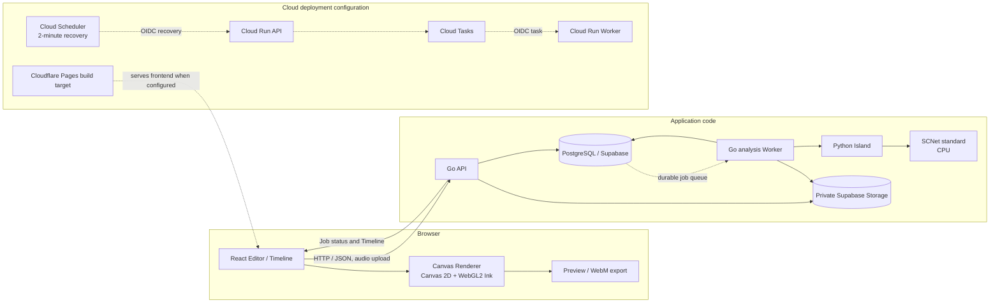

# AI Audio-Reactive Visual Compiler (ARVC)

音源を解析してFeature Timelineを作り、その時系列データに反応するビジュアルを編集・プレビュー・動画出力するWebアプリです。FrontendのEditorとRenderer、Go API、Pythonによる音源解析を分け、解析データと描画設定を別々に扱います。

> **実装状況:** READMEはGitHub `main`のコードと公開リポジトリ内の資料を説明します。クラウド用テンプレートはありますが、現在のProduction状態を公開repo metadataだけから照合できません。稼働中の環境について未確認のURL・機能保証は記載していません。

## Features

### 音源解析

- WAV/MP3の読み込みと解析区間の指定。解析APIでは44.1 kHz stereo PCM16 WAVに変換し、最大60秒・リクエスト本文16 MiBまでを受け付けます。
- Python IslandでSCNet standardをCPU実行し、drums / bass / vocals / otherのStemを使ってFeature TimelineとMusic Summaryを生成します。標準処理はSCNetです。Demucsは開発用の比較・評価経路で、API標準エンジンではありません。
- TimelineにはEnvelope、Kick/Snare推定イベント、Drum Energy、signed PCM peak、Spectrumなどを含められます。Snareはdrums stemのtransient推定で、厳密なstem分離を表すものではありません。
- ローカル解析では音源を外部送信せず、一時ファイルは解析処理後に削除します。クラウド向けStorage経路は実装されていますが、Hosted環境での運用は未確認です。

### Editor・出力

- Timelineを確認し、背景画像、矩形・多角形Region、画像レイヤー、Effect、音響Binding、色・Gradientを編集できます。Regionは正規化座標で保持され、Effectごとに指定Regionでclipされます。
- Pulse / Transform、Waveform、Spectrum、Radial、Particle、Ripple / Shockwave、Ink系などの定義済みEffectをCanvasベースで描画します。Ink系はWebGL2経路を使い、利用できない場合はCanvas 2D描画へfallbackします。
- 同じ`renderEditorFrame`経路をPreviewと動画出力で使います。ローカル音源をPreviewに同期し、Canvas captureとMediaRecorderによるWebM出力を行えます。出力はリアルタイム録画なので、描画計算の決定性はframe cadenceやエンコード結果の一致を保証しません。
- `.arvproj` v1でBlueprint、Timeline、画像、任意の音源を含むProjectを保存・復元できます。ファイルは平文JSONで、暗号化Blueprint形式は実装されていません。
- Cloud Project API / Asset APIとSupabase Storage用のコード・DB migrationsがあります。現行FrontendではCloud Project操作UIを非表示にし、ログイン時の一覧自動取得も行いません。デプロイ環境でのProject routesやHosted保存状態は公開repoから照合できません。

### 認証・利用制御

- Supabase Authによるログインと招待受け入れ、初回パスワード設定を実装しています。一般ユーザー向けsignupは無効です。
- 音声解析にはDB entitlement、期限、quota、rate limit、同時実行枠、kill switchがあります。解析上限や利用可否はサービス設定にも依存します。
- Blueprint生成APIとBudget制御コードはありますが、最新Frontendでは生成UIを非表示にしています。直近のUI変更では生成Sectionと解析状態表示を整理しており、生成経路はEditorから利用できる機能として案内しません。

## Tech Stack

| 領域 | 技術 | 用途 |
|---|---|---|
| Frontend | React 19.3.1, TypeScript 6.0.3, Vite 8.3.5 | Editor、Timeline、Preview、Projectファイル、動画出力 |
| Rendering | Canvas 2D, WebGL2 | 定義済みEffect描画。Ink系WebGL2にはCanvas fallbackあり |
| API | Go 1.27, Echo v5.4.2, pgx v5.12.0 | HTTP API、認証、解析Job、Project/Asset経路。Blueprint生成はGo `net/http`からOpenAI Responses APIを呼ぶserver-side adapterを実装 |
| Audio analysis | Python 3.14, NumPy 2.3.4, PyTorch 2.14.1 CPU | 音源変換、Stem分離、特徴量とTimeline生成 |
| Separation | SCNet standard | APIの標準Stem分離モデル。重みは別途配置しSHA-256を検査 |
| Database / Auth / Storage | Supabase Auth, PostgreSQL, Supabase Storage | ユーザー認証、quota/job/Projectデータ、音源・Asset保存 |
| Cloud configuration | Cloud Run, Cloud Tasks, Cloud Scheduler | API/Worker、Job配送、復旧SchedulerのtemplateとWorkflow。現行Productionへの適用状態はrepoから確認できない |
| Frontend hosting | Cloudflare Pages向けbuild設定 | SPA fallback・headers等のbuild検査。Production公開先は未確認 |
| CI | GitHub Actions | Frontend品質確認、Go race/vet、migration guardとDB検証 |
| Testing | Vitest, Go test, pytest | Frontend、API、解析ロジックの回帰検証 |

依存の正確な版は[`frontend/package.json`](frontend/package.json)、[`api/go.mod`](api/go.mod)、[`python-island/pyproject.toml`](python-island/pyproject.toml)を参照してください。Pythonの固定依存と推移依存は[`python-island/uv.lock`](python-island/uv.lock)にあります。

## Architecture

以下は、コード上の責務分離と、Cloud用templateに記述された接続関係です。破線はtemplate上の関係を示します。



FrontendではBlueprint（Scene / Region / Effect / Binding）とFeature Timelineを別データとして保持します。Rendererはそれらと時刻から描画命令を評価し、Canvasへの描画を行います。AIが生成した任意のJavaScript・Python・GLSLを実行する仕組みはありません。

## Processing Flow

1. ユーザーが音源を選び、解析区間を指定します。
2. Go APIが認証と入力制約を確認して解析Jobを受け付けます。ローカル構成ではDB-backed queueとWorkerが状態を管理します。
3. WorkerがJobをclaimし、Python Islandを呼び出します。Pythonは音声を標準形式へ変換し、SCNet standardでStemを分離してTimeline / Summaryを生成します。
4. Workerが結果とJob状態をPostgreSQLへ記録します。Storage経路では音源をprivate bucketへ置き、DB上のintent/outboxとcleanup処理を使います。
5. FrontendはJob状態を取得し、TimelineをEditorへ反映します。Timelineは解析結果、Blueprintは編集可能な演出設定を保持します。
6. EditorのBindingがTimelineの連続値・イベントをEffectへ対応づけます。RendererはBlueprint、Timeline、再生時刻からフレームを評価します。
7. Previewは選択音源と再生位置を同期します。WebM出力も同じEditor frame rendererを利用します。

Cloud構成のコードではCloud TasksにJob IDを配送し、Cloud Run WorkerがOIDC taskを処理するadapterとtransactional outboxがあります。DBのJob claimとattempt fencingが実行権を管理し、Cloud Schedulerはdispatch復旧endpointを定期呼出しするtemplateです。Cloud Tasks transportは明示flagが必要で、templateではdisabledです。実環境の作成・適用状態はrepoのみから判定できません。

## Engineering Decisions

| 課題 | 実装上の判断 | 確認できる効果と制約 |
|---|---|---|
| Web APIと音源解析で異なる実行環境が必要 | 実装ではGoがAPI / 認証 / Job lifecycleを担当し、Python Island CLIを子プロセスとして起動します。Pythonは分離・特徴抽出を担当 | GoからPythonへの別HTTP serviceを介さず、request contextで終了を伝播し、一時作業領域と出力validationを境界に置けます。一方、CLI起動とモデルloadが解析経路に含まれます。資料にはこの分割を選んだ当初の動機の詳述はありません。
| 長い解析を受付APIと同じ処理に閉じ込めない | 同期handlerを残しながら、DB-backed durable Job、Worker、status / cancel APIを追加 | queued中は解析quotaをreserveせず、Worker claim時に既存解析・quota lifecycleを使います。PostgreSQLが状態とclaim権限の正本です。[Queue設計](docs/reports/2026-11-05-step7k-50b-audio-analysis-job-queue.md)、[実装と隔離検証](docs/reports/2026-11-05-step7k-50c-durable-queue-hosted-cicd.md)
| 重複配送やWorker停止後の再claim | DB lease / attempt fencing / transactional outbox / Job単位quota reservationを使います。Cloud TasksはJob ID配送のtransportとして接続 | 古いattemptの完了・精算を拒否し、再claimを隔離PostgreSQLで検証。DB確定前に停止した場合は推論を再実行し得るため、exactly-once推論や未保存結果の復元は保証しません。[Quota・recovery検証](docs/reports/2026-11-05-step7k-50d-queue-recovery-parallel-benchmark.md)、[Cloud Tasks Worker](docs/reports/2026-11-05-step7k-50e-cloudtasks-worker.md)
| 音源・解析結果と描画設定を独立に編集する | Feature TimelineとBlueprintを分け、Bindingで両者を接続 | 解析結果をEffect個別パラメータから独立して保持。Project/Cloud API payloadはversion付きデータとして検証。[解析からEditorへの接続](docs/reports/2026-11-01-step7k-12-analysis-to-editor-flow.md) |
| AI出力を安全にEditorへ取り込む | AIはBlueprintデータを返し、Backend / Frontend validatorでschema・値を検査。任意コードは実行しない | Rendererが扱うEffect種類・パラメータは定義済み。AI生成UIは現在非表示。[Provider移行・契約](docs/reports/2026-11-01-openai-gpt-6-luna-provider-migration.md) |
| 多様な描画と動画出力の整合 | PreviewとWebMが共通の`renderEditorFrame`を使う | 描画ロジックの共有をコードで確認。実ブラウザ・各codec間の画素一致やFPSは未保証。[Editor連携](docs/reports/2026-11-01-step7k-12-analysis-to-editor-flow.md)、[WebM/MP4 export調査](docs/reports/2026-11-02-step7k-30-webm-mp4-export.md) |
| CPU実行と解析資源の制約を管理する | CPU-only PyTorch、60秒/16MiB入力上限、600秒解析timeout、quota・rate / concurrency制御を実装 | 60秒の実測は単一プロセス条件のみ。2並列のSCNet負荷はRAM不足リスクを避けるため未測定。Cloud料金のhard capや月額1,000円以内を保証しません。[GCP案比較・費用条件](docs/reports/2026-11-02-step7k-32-gcp-architecture-cost-validation.md)

### 音源分離モデルとCPU実測

Python Islandの既定separatorはSCNet standardです。Step 7k-36の報告は、DemucsからSCNetへの変更を承認済みの移行として記録し、API / Timeline v1 / Feature Extractorを変えず、Demucsを開発用optional extraへ移しました。比較資料は採用理由を性能優位とはしていません。60秒の同一音源・Linux CPU・2 threadsによる3プロセス測定では、warm wall中央値がDemucs 47.95秒 / SCNet 52.18秒、peak RSS中央値が1,417.75 / 2,149.09 MiBでした。Python / NumPy / PyTorch版と推論wrapperは異なるため、モデル単体の因果比較ではありません。Kick/Snareの正解ラベルとブラウザ画素評価も不足しており、分離品質の優劣や精度は結論していません。[比較評価](docs/reports/2026-11-02-step7k-34-scnet-demucs-final-evaluation.md)、[同一ホストCPU/RSS測定](docs/reports/2026-11-02-step7k-35-scnet-adoption-validation.md)、[既定separator統合](docs/reports/2026-11-02-step7k-36-scnet-production-integration.md)。

SCNet checkpointはサイズとSHA-256を固定し、`weights_only=True`、strict state loadingを使います。重みはGitに入れず、自動downloadもしません。PoCでは公式PyTorchを比較基準にし、変換元を確認できない第三者ONNXは採用しませんでした。[PoC方式とライセンス調査](docs/reports/2026-11-02-step7k-33-scnet-poc-evaluation.md)。

### Cloud Run案と費用制約

Cloud Runの初期案では、現行Go→Python子プロセス方式を保つ同一image/service、APIと解析serviceの分離、Cloud Run Jobsを比較しました。同期APIとの互換性・追加のnetwork/IAM/storage handoff・scale境界を整理した設計比較であり、費用や実環境性能を測った結果ではありません。解析を非同期化した後はDB-backed queueを採用し、Cloud Tasksはdelivery、PostgreSQLはjob状態とclaimのsource of truthとして役割を分けました。[GCP構成比較](docs/reports/2026-11-02-step7k-32-gcp-architecture-cost-validation.md)、[Cloud release readiness](docs/reports/2026-11-05-step7k-51-cloud-release-readiness.md)。

## Reliability and Security

- Supabase JWTのissuer / audience / expiry検証をGo APIで行い、DB側ではRLS・権限境界とowner scopeを設定しています。
- 解析Jobは状態遷移、lease、attempt fencing、idempotency key、quota reservation/settlementを持ちます。quota reservationはJobに結びつけ、一つのJobで二重精算されないようDB制約・RPCで管理します。
- 解析APIの同期・非同期経路に入力上限、最大60秒の解析区間、最大600秒の解析timeoutと実行枠制御があります。設定値は絶対的な復旧・可用性保証ではありません。
- Cloud Tasksは既定disabledで、明示的な有効化なしには起動しません。Cloud Runはprivate WorkerとOIDCを想定したtemplateです。Scheduler recovery jobも未作成です。
- Supabase Storageはprivate object、owner-scoped read、service-side write、upload intent / cleanup outboxを使う設計です。隔離DB/Storage上の検証は記録されていますが、Hosted設定・容量・費用はrepo上の記録だけでは現況を確認できません。
- `AUDIO_ANALYSIS_ENABLED`等の停止flagとDB controlがあります。停止時の既存Job・Storageデータの扱いはCloud Run手順書を参照してください。

詳細：[Cloud Run / Cloud Tasks運用テンプレート](deploy/cloud-run/README.md)、[API contracts](docs/API_CONTRACTS.md)、[Environment guide](docs/ENVIRONMENT_GUIDE.md)。

## Testing and Quality

現在のGitHub Actionsで実行する主なチェックは次のとおりです。

- Frontend: TypeScript typecheck、ESLint、Vitest、production buildとPages build検査。
- Go: `go test -race ./...`、`go vet ./...`。
- Database: forward-only migration guard、Hosted migration manifest、fresh local Supabase上でのmigration適用・sentinel保持・RLS/ACL/SQL回帰確認・`supabase db lint`。
- Python: audio / feature / SCNet関連のpytest suiteがあります。現在のGitHub ActionsにはPythonテストjobは定義されていません。Demucs統合テストは事前配置された開発用checkpointが必要です。

現行WorkflowはREADME変更をtrigger pathに含めていません。そのためこのREADME-only PRではGitHub Actions runが起動せず、required CI statusを取得できませんでした。最新のCI状態は[GitHub Actions](https://github.com/JunA-priv/audio-reactive-visual-compiler/actions)で確認してください。過去の実行結果を今回のPASSとして扱っていません。SCNet/GPU/browserを必要とする一部の実画面・描画評価は自動CIの範囲外です。


## Implementation Evidence

READMEの主要な設計説明から実装・検証根拠へ移動できるよう、関連する公開repo内資料をリンクしています。詳細な提案・検討結果は確定仕様と区別してください。

- [音源解析からEditorへの接続](docs/reports/2026-11-01-step7k-12-analysis-to-editor-flow.md)：crop WAV、Timeline/Summary、Blueprint validation、Preview audio clockの境界。
- [Visual EditorのResponsive UI](docs/reports/2026-11-04-step7k-48-responsive-visual-editor.md)：Editorの画面順と狭幅UI。ブラウザでの受け入れは未確認と記録。
- [Project / AssetをUIから隠した理由と再有効化条件](docs/reports/2026-11-02-step7k-19-cloud-ui-defer.md)、[再有効化メモ](docs/CLOUD_PROJECT_REACTIVATION.md)。
- [Hosted migration blockers](docs/reports/2026-11-05-step7k-57b-hosted-migration-blockers.md)：Hosted適用前に解消した容量・migration課題と、Hostedに適用したか否かの境界。
- [招待URLと初回パスワードのFrontend設計](docs/reports/2026-11-05-step7k-58f-2-invite-fragment-confirmation.md)：fragment token、explicit user action、URL scrub、signup disabled。

## Deployment and Local Setup

GitHubリポジトリは[JunA-priv/audio-reactive-visual-compiler](https://github.com/JunA-priv/audio-reactive-visual-compiler)です。GitHub repository metadataにHomepageは設定されておらず、この作業でProduction URLのlive応答やdeployment commitを照合できませんでした。Production URLは推測で掲載していません。

Windows 11 + WSL2での開発環境profile、依存導入、起動・停止方法は[Environment Guide](docs/ENVIRONMENT_GUIDE.md)と[Environment Setup](docs/ENVIRONMENT_SETUP.md)を参照してください。

Frontend単独で依存を導入して確認する場合：

```bash
cd frontend
npm ci
npm run typecheck
npm run lint
npm test
npm run build
```

標準SCNet checkpointはGitやpackageに含まれず、自動ダウンロードもしません。配置場所、SHA-256、Python環境の準備は[Python Island README](python-island/README.md)を参照してください。API / DB / Authを含む構成はEnvironment Guideのprofile launcherを利用してください。

## Limitations

- 解析APIは44.1 kHz stereo PCM16 WAVを受け付け、区間は最大60秒、multipart request全体は最大16 MiBです。長い音源は区間を分けて解析します。
- 音源解析はCPU実行です。Step 7k-35のCPU/RSS benchmarkは60秒のdemo4 crop、同一Linux host、2 threads、各model 3 processで実施しましたがruntime/library versionsとwrapperが異なります。実SCNet 2並列負荷は未測定です。
- Kick / Snareは推定イベントです。注釈付きtruth setによる検出精度は確立していません。
- `.arvproj`は平文JSONです。復元時のSHA-256整合性検査はありますが、暗号化・機密保護を提供しません。
- WebGL2 Ink fallbackはありますが、実ブラウザの視覚品質、ブラウザ間の描画差、WebM codec互換性やFPSは一律検証されていません。
- Hosted SupabaseとGCPのresource / IAM / capacity / failure recovery / costの現況は、公開repoから照合できません。templateとCIは存在しても、月額費用の上限や本番availabilityを保証しません。
- AI Blueprint生成のBackend実装はありますが、Frontendの生成UIは非表示です。暗号化Blueprint、AI素材生成、一般signup、課金機能は利用可能な機能として提供していません。

## Future Development

以下は現行実装と区別した開発候補です。実施順・時期は確定していません。

- AI Blueprint生成をEditor UIへ再統合する条件・操作・安全性の整理。
- Typography / Glyph / Text系、画像distortionなど追加Effectの検討。既存Canvas/WebGL Rendererと性能・seek再現性への影響を評価する。
- Kick / Snare等の推定品質を、確認済み注釈と評価データで改善する。現状はaccuracyを主張できる正解データがありません。
- Timeline特徴量とKick / Snare推定を、確認済みannotationと複数の権利確認済み音源で評価する。Step 7k-34/35は検出精度を出せる人手ラベルを持たず、model comparisonをaccuracyと扱っていません。
- Cloud Projectと画像・素材編集の拡張。現行Cloud routesが無効のtemplate、およびHosted DB/Storage運用条件を先に確認する。
- Cloud Run / Tasks / Scheduler、Hosted Supabase、Cloudflare Pagesのdeployment状態・権限・容量・費用の証拠を整え、ブラウザ・負荷・復旧の受け入れ結果を現在のmainと同期する。

Effect候補の詳細は[Visual Effect Roadmap](docs/VISUAL_EFFECT_ROADMAP.md)を参照してください。この資料も提案を含み、記載候補が実装予定として確定したことを意味しません。
