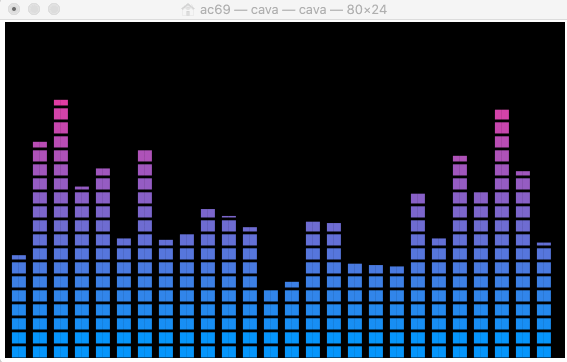

# ビジュアルエフェクトのロードマップ

**プロジェクト：** AI Audio-Reactive Visual Compiler  
**状態：** 提案  
**作成日：** 2026-10-31  
**対象：** 将来のビジュアルエフェクト拡張方針

## 1. 目的

本ドキュメントは、AI Audio-Reactive Visual Compilerにおけるビジュアル表現の最終的な方向性と、将来追加するエフェクトの候補、責務、技術的な検討事項を整理する。

現在のMVPでは、音響特徴量とエフェクトの連動、Blueprintの編集、Regionによる適用範囲制御、決定論的な描画処理を優先している。

今後はこれらを基盤として、音楽に同期しながら有機的・抽象的に変化する、芸術性の高い映像表現を実現する。

本ドキュメントは将来拡張の検討資料であり、記載した機能を現在のMVPに追加するものではない。

## 2. ビジュアル表現の基本方針

### 2.1 プロダクトの方向性

単なる周波数スペクトラム表示ではなく、音楽の構造やエネルギーを、抽象的な映像表現へ変換するビジュアライザーを目指す。

主な表現イメージ：

- 水にインクを垂らしたような拡散と変形
- マーブリングアートのような流動的な模様
- 光や粒子が爆発・拡散・収束する表現
- 文字や記号が飛散・回転・発光する表現
- 円形スペクトラムや放射状の音響表現
- 音楽に合わせて空間が歪み、色彩や形状が変化する表現

### 2.2 設計原則

既存の次の責務分離を維持する。

| 要素 | 責務 |
|---|---|
| Feature Timeline | 音響特徴量とイベントを保持 |
| Binding | 音響Sourceとエフェクト制御を対応付ける |
| エフェクト | 視覚的な表現とそのパラメータを定義 |
| Region | エフェクトの適用領域を定義 |
| Visual Blueprint | Scene、Region、Effect、Binding等を保持 |
| Renderer | Blueprintと特徴量から映像を描画 |

AIは演出構成を提案し、ユーザーはその結果を編集する。Rendererは定義済みのエフェクトを実行し、AIが生成した任意コードを直接実行しない。

### 2.3 再現性

同一のBlueprint、Feature Timeline、時刻、Rendererバージョン、Random Seedなどの再現性に必要な入力から、同じ描画結果を得られることを目指す。エフェクトの追加によって、既存の決定論的描画の原則を破壊しない。

時間発展型の流体表現については、状態の再計算、固定時間刻み、チェックポイント、事前計算などを検討する。同じ時刻へのシークで映像を再現できることを重要な要件とする。GPU・ブラウザ間の画素単位での完全一致は現時点では保証対象としない。

## 3. エフェクトの分類

### 3.1 スペクトラム／ビジュアライザー

音響特徴量を波形・線・図形として表現する。

| エフェクト | 表現 |
|---|---|
| Bars | 直線状のスペクトラムバー |
| Radial Bars | 円周に沿ったスペクトラム |
| Wave Ring | 音量に応じて変形するリング |
| Oscilloscope Line | 波形状のライン |
| Frequency Ribbon | 帯状に流れるスペクトラム |

周期的・連続的な音響変化との相性がよい。Canvas 2Dで実装でき、MVPのWaveform/Barsを再利用・拡張できる。

参考イメージ：音量に合わせて高さが変わるSpectrum Bars。

### 3.2 パーティクル

粒子や光の生成・移動・消滅によって音のエネルギーを表現する。

| エフェクト | 表現 |
|---|---|
| Burst Particles | 中心から粒子が爆発的に拡散 |
| Trail Particles | 残像を伴う粒子の移動 |
| Orbit Particles | 中心や軌道に沿った粒子運動 |
| Dust / Noise Drift | 微細粒子の浮遊・揺らぎ |
| Spark Emission | 瞬間的な発光粒子の発生 |

KickやOnsetを発生トリガーに利用し、Bass Envelopeなどで粒子密度や広がりを制御する。粒子位置は時刻とSeedから再計算できる方式を優先し、大量描画ではGPU利用を検討する。

参考イメージ：文字片と光点が中心から飛散する、Particle Burst / Fragment Scatterの方向性。

### 3.3 タイポグラフィ／シンボル

文字・数字・記号を図形素材として扱う。

| エフェクト | 表現 |
|---|---|
| Glyph Burst | 文字や記号の放射・爆発 |
| Character Orbit | 文字群の周回 |
| Text Stream | 流動する文字列 |
| Symbol Rain | 記号の降下 |
| Fragment Scatter | 文字や図形の断片化・飛散 |

音響イベントと移動・回転・発光を連動させる。フォント・文字集合・色彩・密度を設定可能にすることを検討する。歌詞同期や高度なタイポグラフィ編集は別要件とする。

参考イメージ：文字・記号を光る図形素材として放射・飛散させる表現。

### 3.4 流体／マーブリング

流体・インク・煙・色素の拡散を模した有機的な表現。将来の芸術的なビジュアル表現として特に重視するFamily。

| エフェクト | 表現 |
|---|---|
| Ink Drop | インクの滴下・広がり |
| Ink Diffusion | 色素の拡散・にじみ |
| Marbling Flow | マーブリング状の模様変形 |
| Fluid Swirl | 流体の渦・攪拌 |
| Smoke Bloom | 煙状の膨張・拡散 |
| Pigment Mixing | 複数色の混合・流動 |

有機的で連続性のある映像表現を重視する。音響特徴量によって流速・密度・広がり・色彩を制御する。リアルタイム流体シミュレーションは技術検証対象とし、物理的に正確な流体再現は必須としない。プレビュー性能と再現性を優先する。

参考イメージ：色素の混合・煙状の拡散・Ink Diffusionの方向性。

### 3.5 フィールド／歪み

画面や画像の一部を変形・歪曲する表現。

| エフェクト | 表現 |
|---|---|
| Ripple Field | 波紋による座標変形 |
| Shockwave | 衝撃波による空間変形 |
| Vortex Warp | 渦状の歪曲 |
| Glow Field | 発光領域の変化 |
| Chromatic Distortion | RGB成分のずれ・色収差 |

背景画像との合成を重視し、Regionとの連携を前提とする。テクスチャ参照・ピクセル変形を伴う場合はWebGL等を検討する。

## 4. 音響特徴量とエフェクトの対応

以下は初期の演出設計候補であり、固定的な対応を強制しない。

| Audio Feature | 視覚的な制御候補 |
|---|---|
| Kick Onset | Burst、Ink Drop、Shockwave、Pulse |
| Bass RMS / Envelope | 流動速度、膨張、密度、色彩変化 |
| Drum Energy | Particles、Ripple、Movement |
| Snare / Mid Onset | Spark、Glyph Burst、Noise Scatter |
| Vocals Energy | Glow、Swirl、Organic Deformation |
| Other / High-band | 微細粒子、細線、ハイライト |
| Overall RMS | シーン全体の強度・明度・スケール |

Snareや帯域別特徴量など、現MVPのFeature Timelineに存在しないものは将来の音響解析拡張候補とする。

FACT（Step 7k-2、2026-11-01）：Timeline v1へ`snare.events`、既存`drumEnergy`の`drums.energy` Binding、`vocals.envelope`、`other.envelope`、`music.energy`を加法追加した。SnareはDemucs drums stem中のmid/high transient推定で、厳密なstem分離ではない。詳細はStep 7k-2報告を参照。

### 4.1 イベント型と連続値型

イベント型：Kick Onset、Snare Onset（将来候補）、Transient Event（将来候補）。  
連続値型：Bass Envelope、Drum Energy、Vocal Energy（将来候補）、Band Energy（将来候補）。

イベント型はエフェクトの発生や瞬間的変化、連続値型は持続的な状態変化に利用できる。BindingではSource、Strength、Threshold、Attack、Releaseなどを管理し、Effect固有の描画パラメータとは区別する。

## 5. エフェクトパラメータ

将来のエフェクトでは、必要に応じて以下のパラメータを検討する。

| 分類 | パラメータ候補 |
|---|---|
| 表示 | Color、Opacity、Blend Mode |
| 幾何 | Position、Size、Scale、Rotation |
| 動作 | Speed、Direction、Spread |
| 粒子 | Count、Density、Lifetime |
| 流体 | Diffusion、Viscosity、Swirl、Turbulence |
| 発光 | Glow Intensity、Bloom Radius |
| 再現性 | Seed、Time、Simulation Parameters |
| 適用範囲 | Region Reference |

すべてのEffectに同じパラメータを持たせる必要はない。Effectの種類ごとに必要なパラメータを定義し、Blueprintスキーマで検証する。上記の名前・型・単位・範囲は未確定であり、実装時に正式仕様へ反映する。

## 6. 描画技術の選択肢

### 6.1 Canvas 2D

Bars / Radial Bars、Wave Ring、基本的なParticle Burst、Glyph Burst、単純なRipple、擬似的なInk Drop / Blob表現を候補とする。既存Rendererを再利用しやすく、実装・検証コストを比較的低く抑え、時刻ベースの決定論的処理を構築しやすい。一方、高密度粒子やピクセル単位の変形では性能上の制約があり、本格的な流体表現には向かない場合がある。

### 6.2 WebGL／シェーダー

Ink Diffusion、Marbling Flow、Fluid Swirl、Smoke Bloom、Reaction-Diffusion、Feedback Texture、Noise-driven Flow Field、高密度Particle、Texture Distortionを候補とする。GPU並列描画やテクスチャ処理に適する一方、描画エンジンの複雑化、WebGL対応環境、GPU差異、状態依存型シミュレーションの再現性、動画出力との整合性を検証する必要がある。

### 6.3 Rendererの拡張方針

現時点ではCanvas 2Dを維持する。将来WebGLを導入する場合も、既存のBlueprint、Binding、Region、Feature Timelineの責務を維持する。ただし既存Canvas命令形式がGPU処理へそのまま適用できるとは限らない。WebGL導入時に必要となる描画バックエンドの分離や中間表現の拡張は、その時点で既存コードを評価して判断する。現段階では将来のWebGL対応を理由にRendererを再設計しない。

## 7. Regionとエフェクトの関係

現在のRegionは矩形・多角形によってエフェクトの適用範囲を指定する。将来のFluid、Particle、DistortionについてもRegionとの連携を基本とする。ただし、次の振る舞いは区別する。

1. **描画クリップ**：Region外への描画を禁止する
2. **発生領域**：Region内から粒子・流体を発生させる
3. **影響領域**：Region内でのみ変形・流動を計算する

現MVPで実装されているのは主として描画クリップである。発生領域・影響領域の高度な制御は将来検討とする。

## 8. 実装ロードマップ

### Phase A：MVP表現の強化

目的：既存Rendererの機能を活用して表現力を高める。候補はRadial Bars、Wave Ring、Particle Burst、Particle Trail、Ripple / Shockwave、Glow表現の改善。Canvas 2Dを第一候補とする。

FACT（2026-11-01）：Step 7h-1でRadial Bars/Wave Ring、Step 7h-2でParticle Burst/Trail、Step 7h-3でRipple/ShockwaveとGlow intensityの任意拡張を既存Canvas 2D Rendererへ実装した。Phase Aの機能実装候補は完了。全追加表現の実ブラウザ視覚品質・WebM再生・FPSは人手評価待ち。

FACT（Step 7k-1、2026-11-01）：既存Phase A Effectに任意の強調パラメータを追加し、`oscilloscope-line`疑似波形をBlueprint v1へ加法的に追加した。Radial Barsはテーパー状スパイク、Wave Ringは密なBass Envelopeサンプル、Burst/Trail/Ripple/Shockwave/Glowは発光・強度パラメータで描画を強調する。Preview/WebMの`renderEditorFrame`経路とRegion clipは共通。現ブラウザでの実画素品質・WebM再生/FPSは未確認。

### Phase B：抽象MV表現の拡張

目的：単純な音響可視化から独自の映像表現へ発展させる。候補はGlyph Burst、Text Stream、Character Orbit、Glow / Bloom表現、Background Distortion、Organic Blob。Canvas 2Dを基本とし、必要に応じてGPU描画を検討する。

### フェーズC：流体／マーブリング表現

目的：芸術性の高い流体・色素表現を実現する。候補はInk Drop、Ink Diffusion、Marbling Flow、Fluid Swirl、Smoke Bloom、Pigment Mixing。

検討対象：WebGL / Shader、流体風シミュレーション、Noise-driven Flow Field、状態の再現・シーク、パフォーマンスと解像度、Regionとの合成、動画出力との一致。

Phase A〜Cは将来の開発順序案であり、現在のMVP実装範囲とは別に扱う。

## 9. 技術的な未解決事項

| 項目 | 状態 |
|---|---|
| WebGL採用の必要性 | PROPOSED |
| 流体シミュレーション方式 | 未確定 |
| 流体表現の再現性確保 | 未検証 |
| GPU・ブラウザ間の描画差異 | 未検証 |
| シーク時の流体状態復元 | 未設計 |
| Particle大量描画性能 | 未計測 |
| Regionと流体の相互作用 | 未設計 |
| 動画書き出しとの一致 | 未検証 |
| 各Effectの正式なパラメータ定義 | 未確定 |
| エフェクト分類のschema表現 | 未確定 |
| Geminiによる高度な演出提案 | 未検証 |
| 演出品質とユーザー評価 | 未検証 |

未解決事項を、検証済みの技術的事実として扱わない。

## 10. 現MVPとの関係

現在実装している5種類のEffectは、最終的なビジュアル表現の完成形ではない。現MVPの目的は、音響特徴量とエフェクトの連動、Effect / Binding / Regionの責務分離、Blueprintによる宣言的な演出定義、ユーザーによる演出編集、時刻ベースの再現可能なRenderer、プレビューと動画出力に向けた描画基盤を成立させることである。

芸術的な表現の高度化は、これらの成立後に段階的に検討する。将来のEffect追加では、既存MVPの互換性・再現性・性能を維持する。

## 11. 現時点の決定事項

**DECIDED**

- 現在のMVPの実装範囲は拡大しない
- AIによる演出設計とRendererによる描画を分離する
- Feature Timeline / Binding / Effect / Regionの責務を維持する
- 現在のRendererはCanvas 2Dを基本とする
- 描画の再現性を重要な設計原則とする
- 将来は芸術性の高い音響連動映像表現を目指す

**PROPOSED**

- Spectrum、Particle、Typography、Fluid、Distortionの5 Family
- Fluid / Marbling系を将来の重点分野として検討する
- Canvas 2Dによる表現強化後、必要に応じてWebGLを導入する
- Phase A〜Cの順序でエフェクトを拡張する
- 音響特徴量の種類を将来的に拡張する

## 12. 更新ルール

将来Effectを正式に実装する場合は、以下との整合性を確認する。

- `docs/REQUIREMENTS.md`
- `docs/ARCHITECTURE.md`
- `docs/BLUEPRINT_SPEC.md`
- `docs/TEST_STRATEGY.md`
- `docs/CURRENT_STATE.md`
- `docs/DECISION_LOG.md`

本ドキュメントは将来構想を扱うため、記載内容だけを根拠にCURRENT_TASK.mdの作業範囲を追加しない。実装を開始する場合は、対象Effect、責務、入出力、互換性、完了条件を別途確定する。

FACT（Step 7k-4〜7k-7、2026-11-01）：Wave Ring uses periodic interpolation with configurable smoothing; circular Ripple/Shockwave use continuous circle geometry and event easing. Added `waveform-line`, `waveform-peak-bars`, `waveform-ring` driven by signed Timeline peaks. All Effects can bind any of the seven current sources, with deterministic Event/Continuous conversions. Blueprint/Timeline/Project v1 and Canvas 2D common preview/export path remain. Browser visual quality and FPS remain pending.

FACT（Step 7k-8、2026-11-01）：radial-bars / wave-ring / waveform-ring rotation uses BPM and beats-per-revolution 4/8/16/32, with direction, initial angle, continuous or source-triggered mode. Eight beats/revolution is the new Effect default. BPM comes from stable Kick onset intervals or explicit 120 BPM fallback. This provides constant-tempo rotation only; exact beat phase is not estimated.

FACT（Step 7k-9、2026-11-01）：既存Wave Ringを最大6層へ加法拡張し、全15 Effectに共通Opacityを追加した。新規Wave Ring UIの初期layerCountは4、旧Blueprintは単層表示を維持。v1保存契約、Canvas 2D、Preview/WebM共通経路は不変。自動テスト結果と未確認の実ブラウザ視覚評価は[完了報告](reports/2026-11-01-step7k-9-layered-wave-ring-opacity.md)を参照。

FACT（Step 7k-10当初仕様、Step 7k-10bで置換）：Wave Ring now supports up to 10 layers with automatic half-circle step 180/layerCount; positive angle setting remains manual. All 15 existing Effects expose Triggered/Always and Audio Reactive settings. Legacy omitted settings preserve prior behavior; new Editor Effects default Always + Reactive. v1 Blueprint/Project/Cloud and Preview/WebM renderer remain. See [Step 7k-10 report](reports/2026-11-01-step7k-10-wave-ring-visibility.md).

FACT（Step 7k-10b correction、2026-11-01）：Wave Ring automatic layer step is `360 / layerCount` (3/4/6/10 layers: 120/90/60/36°). Every layer uses the same radius; legacy `layerRadiusStep` remains accepted but is ignored for Wave Ring rendering and hidden in its Editor controls. The common sample sequence is rotated only in Canvas coordinates, together with BPM rotation and initial angle. Blueprint/Project/Cloud v1 and Preview/WebM renderer remain.

FACT（Step 7k-11a、2026-11-01）：Adds two Spectrum Effects (`spectrum-bars`, `spectrum-line`) under the independent UI Category `EQ / Spectrum`; legacy Waveform Category membership is unchanged. Optional Timeline v1 Spectrum is 32 log bands, 20ms hop and uint8 quantized. Renderer uses the decoded music FFT distribution and the selected Binding as additional response. Preview and WebM share `renderEditorFrame`; Blueprint/Project/Cloud versions remain v1. See the Step 7k-11a report.

FACT（Step 7k-11c、2026-11-01）：既存`particles`を上昇系の複数粒子フィールド、`particle-burst`を決定論的な全周放射/swirl Burstへ改善。Effect kindとBlueprint v1は維持し、Effect parameterのみoptional加法拡張。詳細は[Step 7k-11c報告](reports/2026-11-01-step7k-11c-particle-effects.md)。

FACT（Step 7k-11d、2026-11-01）：`ink-diffusion` adds a deterministic Canvas 2D ambient ink treatment using multi-cloud, smooth harmonic-noise contours and translucent nested fills. It uses existing seven Binding sources with a deterministic response-time follower; no Timeline feature or dependency was added. The UI derives `Ambient / Atmospheric` from the Effect kind. A future fluid/3D implementation remains a separate proposal; no 3D renderer abstraction or GPU path was added. See the [Step 7k-11d report](reports/2026-11-01-step7k-11d-ink-diffusion.md).

FACT / PARTIAL（Step 7k-11e、2026-11-01）：Ink-only Canvas geometry now uses overlapping rising plume ribbons with layered translucent contours and six curved branches around deterministic vortex centers. Bounds are 12 commands / 600 supplied contour vertices per Effect. Four effects took 120.01ms for 240 JS evaluation frames (0.50ms/frame; excludes Canvas rasterization). Browser visual acceptance and raster FPS remain unverified. Technology review favors keeping Canvas2D until human browser review; if rejected, a local WebGL2 offscreen shader composited through the existing 2D renderer is the leading candidate. PixiJS adds package/lifecycle overhead; WebGPU is unnecessary for this 2D effect. No GPU implementation or dependency was added. See the [Step 7k-11e report](reports/2026-11-01-step7k-11e-ink-visual-quality.md).

FACT / PARTIAL（Step 7k-11f、2026-11-01）：Ink限定WebGL2 fragment shaderを追加し、flow-warped multi-octave density field、局所渦、filament ridge、Gradient/Custom pigment mixingを透明Region-sized offscreen canvasへ描く。既存Canvas2Dへ同じEffect順で合成し、Preview/WebM shared rendererを維持。Contextは最大4件で再利用、resize/context-lossとWebGL2/Shader failure fallbackを実装。依存は追加せず、他EffectはCanvas2Dのまま。ブラウザ/GLSL compilerがなく実GPU描画・FPS・WebM visual acceptanceは未確認、status partial。詳細は[Step 7k-11f報告](reports/2026-11-01-step7k-11f-ink-webgl2.md)。

FACT / PARTIAL（Step 7k-11g、2026-11-01）：Ink shaderを中心coreと4つのseed/timeで軌道を変える拡散sourceから始まり、outward expansion / multiple domain warp / 4 vortex / radial filamentsへ広がるdensity fieldに変更。Canvas2D fallbackもcentered cloudとradial branchへ変更。既存parametersとv1 contractsはそのまま。自動testsでは同時刻/seek、t=0/3/8のFallback bounds、Binding応答差を確認。WebGL2 real pixels未確認。詳細は[Step 7k-11g報告](reports/2026-11-01-step7k-11g-ink-expansion-variation.md)。

FACT / PARTIAL（Step 7k-11h、2026-11-01）：全EffectのRenderer geometryをRegionに対して広く配置する調整を実施。InkのWebGL density envelope/expansion frontとCanvas2D fallback reachを拡大し、円形系は矩形Regionの縦横比を使い、waveform/spectrum/particle geometryはRegion dimensionsを基準とする。保存契約・Preview/WebM共通Rendererは不変。Rect/Polygon geometry testsは成功。実画素とFPSはブラウザ未確認。詳細は[Step 7k-11h報告](reports/2026-11-01-step7k-11h-region-coverage.md)。

FACT / PARTIAL（Step 7k-11i、2026-11-01）：`Ambient / Atmospheric`に`ink-flow`と`color-mixing`を加え、既存Ink Diffusionと合わせ20 EffectをUIで選択可能にした。Kindごとに独立したEffect ID/Binding/Opacity/Visibilityを保持。Ink専用WebGL2 shader/contextを共有し、Flowはstream-density ridges、Mixingは複数移動pigment densityを描く。Step 7k-11jのDiffusion density/alpha branch、Region-local UV、Stage Gradient、clip、bounded contextは維持。Blueprint/Project/Cloud v1。自動検証成功。ブラウザ/GLSL compilerがなくGPU画素、実WebM/FPSは未確認。

FACT / PARTIAL（Step 7k-11k、2026-11-01）：Ink Flowの密度場を細い周期リッジ主体から幅のある流体状ストリームへ変更し、body/edgeのalpha差、渦・domain warpを維持。Color Mixingは4成分それぞれ別のdomain warpと移動位相を持つ密度場とし、重み付き色合成・局所境界滲み・厳しめの密度maskで単色面と全域着色を抑制。`color-mixing.customPalette`をoptional追加（2〜4個の`#RRGGBB`）。Global Gradientは共通色で混合、Custom Color＋paletteで密度源ごとの色を割当、palette未指定時は旧単色描画。Diffusion shader branchは変更なし。Blueprint/Project/Cloud v1。自動検証済み。ブラウザGPU画素・shader compile・FPS/WebM目視は未確認。
