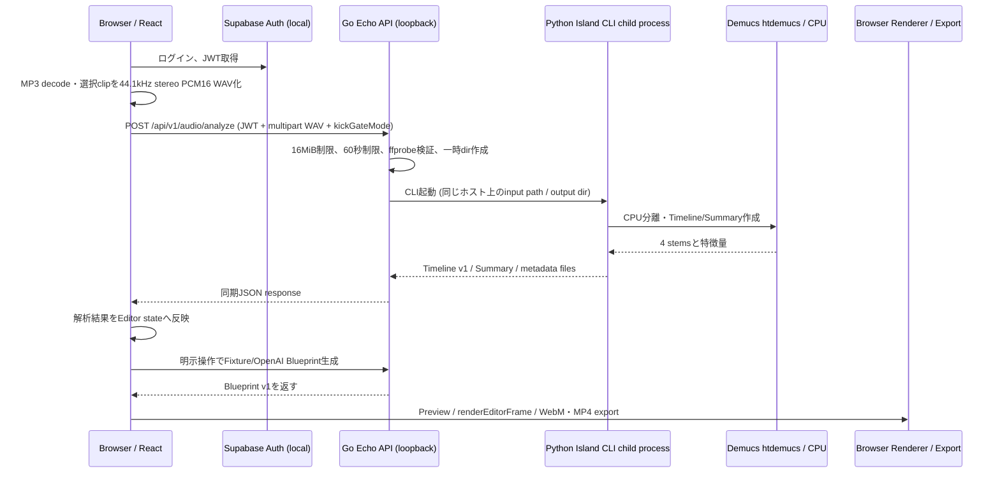

# Step 7k-32 — GCP公開アーキテクチャ設計・コスト検証

調査日：2026-11-02
Status：**設計案作成済み / 公開・推論はNO-GO**
範囲：read-only調査。コード、Hosted設定、課金リソース、デプロイは変更していない。

## 1. 要約

### 推奨案

Demucs重みの公開推論許諾が書面で解決した後の最小構成として、**Cloudflare Pages（静的Frontend）+ Cloud Run Service 1つ（Go APIとPython Island CLIを同じイメージに同梱）+ Supabase Hosted Auth**を推奨する。Audio Analyzeは現在の同期HTTP応答を保ち、Goが同一コンテナ内のPython CLIを起動する。初期の候補容量は2 vCPU / 4 GiB、request-based billing、min instances 0、concurrency 1、最大instance 1を出発点とする。ただしCloud上でのCPU/メモリ/起動時間は未計測で、モデル権利が解決するまでは構築・公開・推論を行わない。

この案は公開APIのリクエスト/レスポンスと既存子プロセス方式を最も保ちやすく、別解析サービス、キュー、結果ストレージ、ポーリングを必要としない。Python依存とcheckpointを含むイメージが大きくなる点、毎解析でPythonプロセスとモデルが再ロードされる点、Go/Pythonが同一スケール単位になる点は実装前に受け入れ試験が必要。

### 公開判定

**現時点で対話型音源解析を公開してはならない。** Step 7k-31が記録したhtdemucs checkpointの公開サービス推論許諾は未解決である。加えて本リポジトリはHosted API/Auth/CORSに非対応で、Cloudflare PagesからAPIを経路指定する本番設定も存在しない。許諾が得られるまで安全な次工程は静的ポートフォリオ案の選択と、権利確認済み素材だけを使う公開物の準備である。

### コスト判定

上記案の**Cloud Run compute**は、60秒clipを1解析あたり60秒または120秒の課金時間と仮定した0/10/50/100/500件の全シナリオで、現行のCloud Run無料枠内に収まる計算となる（Cloud上の実測値ではない）。ただしこれはCloud Run compute/requestだけの結果であり、Artifact Registryの常置イメージ、外部向けegress、OpenAI、ドメイン、税、Supabase有料プラン等を含む実請求の保証ではない。推定固定費・オプション費を合算した500解析/月は概ね**約¥300〜¥350**だが、仮定に強く依存する。Supabase Proは現行掲載価格だけで約¥3,900/月相当のため、¥1,000目標には入らない。Supabase Freeは費用上の候補だが、非活動時pause等を受け入れる必要があり、運用可用性を保証しない。

## 2. 既存実装と実行条件

### 2.1 現行データフロー

Audio Analyze成功後、Blueprintは自動生成されない。利用者が既存の生成操作を明示実行し、Fixture（既定）または設定済みOpenAI経路を使う。解析とBlueprint生成は別HTTP要求である。WebM/MP4はブラウザのMediaRecorder出力で、サーバー側動画エンコード処理はない。

### 2.2 レイヤー別の現状

| レイヤー | 現行の入出力・実行条件 | 公開設計への影響 |
|---|---|---|
| Frontend | React/Vite。ブラウザでMP3をdecodeし、選択clipのみ44.1kHz stereo PCM16 WAVにして送信。最大60秒。認証JWTを`Authorization`へ付ける。API pathは`/api/v1/...`相対URL。 | `frontend/vite.config.ts`の`/api -> http://127.0.0.1:8080`は開発サーバーproxyのみ。Production PagesではCloud Run APIのbase URL/proxyが必要。Hosted Supabase URLも現在拒否される。ブラウザdecode用RAMはCloud Run費用外。 |
| Supabase Auth | Local Supabase REST login/refresh/logout。Frontend `VITE_SUPABASE_URL`, `VITE_SUPABASE_ANON_KEY`。GoはJWT `iss`, audience `authenticated`, UUID subject、ES256、JWKSを検証。 | Hosted URL、HTTPS、exact Redirect URL、signing key/JWKSとES256対応、CORSを検証。公開anon/publishable keyのみFrontend、secret/service-role/DB secretはサーバー限定。 |
| Go API | Echo。`POST /api/v1/audio/analyze`は認証必須。request上限16MiB、clip上限60秒、handler timeout 600秒。process内解析slotは1。Temp dirはprivate mode 0700でrequest終了時削除。ffprobe timeout 20秒。 | Cloud Run request timeoutは600秒より長く設定する（例720秒）。同期応答を保てるがclient disconnect/Cloud Run timeout/SIGTERM時の子プロセス終了とtemp削除をHosted試験する。scale-outすると現在のslotは全instance共通制限ではない。 |
| Python Island | Goが固定Python executableを`exec.CommandContext`で起動。`--threads 4`固定。CLIはローカルWAVをprobe/decodeし、Demucs htdemucs CPU分離後にTimeline v1/Summary/metadataをfile出力。ネットワークから重みを暗黙取得せず、存在とhash prefixを検証。 | PythonをHTTP serverとして独立起動する現行設計ではない。Go/Python/Torch/NumPy/Demucs/FFmpeg/ffprobe/weightsを同じコンテナで利用可能にする必要がある。Python processごとにmodelをloadする。 |
| Demucs | htdemucs 4-stem、CPU。60秒合成WAV→Go HTTPは約33.7秒、peak RSS 1,283.8 MiB。別ローカル音源では約90秒の分離、約96.8秒total、peak RSS 1,644.5 MiB。 | いずれもローカル測定でCloud Run性能の保証値ではない。4GiBは初期試験の候補に過ぎない。重みの公開推論許諾が未解決で、許諾前は公開禁止。 |
| Blueprint | 解析とは別API。Fixture既定。OpenAI modeはAPI側`OPENAI_API_KEY`と認証/DB budget設定が必要。Timeline/Summaryを受け、Blueprint validator後に返す。 | Fixtureは外部AI請求なし。ただし監査報告が指摘するFixture routeの認証/公開直叩き条件をCloud公開前に再確認する。OpenAI請求はCloud Run費に含まれない。 |
| DB / Storage | Local Supabase migrations、Project/Asset APIは実装済みだがCloud Project UIは意図的に非表示。Audio Analyze結果と音声は通常`.arvproj`にローカル保存される。 | 隠されたCloud Project機能の再有効化は提案しない。Hosted DBはAI budgetやAuth運用に必要な範囲を評価し、Storageは当面解析入力保存には不要。 |
| Renderer / Export | Preview/WebMは同じ`renderEditorFrame`。MP4/WebMはブラウザ内MediaRecorder。 | GCPにRenderer/GPU/WebM/MP4用CPUを割り当てない。保存済み`.arvproj`はHosted backupではなく、平文ローカルファイル。 |

### 2.3 一時ファイル、モデルcache、障害挙動

- Goはrequestごとにtemp directoryを作り、正常終了・エラー・timeoutで削除する。Cloud Run container filesystemは永続保存先ではない。Cloud Run Jobs/別Service化では共有pathは存在しないため、明示的な外部データ移送が必要になる。
- `separation.py`は`torch.hub/checkpoints/955717e8-8726e21a.th`を確認してから毎回Demucs modelをロードする。現CLI呼び出しは別Python processなので、モデルオブジェクトはrequestを跨いで再利用しない。重みを起動時ダウンロードする実装ではないため、許諾が解決した場合でも許諾済みweightを含むimage/artifactの配布方法を決める。
- Go handler context cancellationは`CommandContext`とprocess group killへ伝わるが、Cloud Run termination/drainの実機試験は未実施。SIGTERM時にGo server停止、Python child終了、temp cleanup、HTTP応答の境界を検証する。
- Cloud Run serviceは起動4分以内の制約がある。モデルはAPI startup時でなく解析時にCLI内ロードする現行構造なので、container startupとanalysis cold pathを区別して測る。large image pullもfirst request latencyへ影響する可能性がある。

## 3. Cloud Run構成案

| 観点 | A. Go + Python同一Service/image | B. Go Service + Python Service | C. Go API + Cloud Run Jobs |
|---|---|---|---|
| 現行同期API | 最も保ちやすい。現在のGo→子CLI方式を同一container内で使える。 | Public APIの同期応答は維持できるが、Goからprivate Python HTTPへ移行し、stream/JSON、OIDC ID token、内部認可を追加。 | Public APIを同期のままにするならGoがJob起動後にcompletionをpollして結果返却。Jobs自体はjob execution lifecycleとなり内部変更は最大。 |
| Image/process | Go binary + Python 3.14環境 + CPU Torch + Demucs + FFmpeg/ffprobe + 許諾済みweightを一imageにする。 | Python Serviceは解析依存を分けられる。Go imageは小さくできるが、2image、2deploy、IAM設定が必要。Python側に今はHTTP serverがない。 | Python worker imageをJob実行。Go imageと分離可能。GCS等のinput/result handoffを要する。 |
| CPU/RAM | Goと分析で同一memory/CPU上限。解析中は2 vCPU/4 GiB等の単位をService全体へ割り当て。 | APIと解析Serviceの設定を個別に選べる。同期待機中Go Serviceも稼働し、各Serviceのcold startを直列に受ける。 | JobごとにCPU/RAM/timeoutを設定でき、分析workloadをrequest APIから隔離。Task失敗、retry、execution状態管理が必要。 |
| Scale-to-zero/latency | min 0ならidle costなし。大型Python/Torch imageのpullと最初のPython importが遅延候補。 | 2 Serviceが独立にscale-to-zeroし、cold startが連鎖。内部呼出しは同regionならGoogle Cloud内部transfer料金なし。 | Job起動/queue/schedulingの待ち時間が加算。Job最低課金1分。 |
| 受け渡し/障害 | filesystem pathと子processで直接渡す。現行のtemp lifecycleを最大限再利用。 | Go→解析ServiceのHTTP upload/response。Cloud Run service間認証、600秒deadline、失敗/取消の伝播を設計。 | ブラウザWAVを一時Storageへ置きJobへ渡し、outputをStorageへ保存してGoが読み出す。job ID、poll、cancel、retry、cleanup/TTL、冪等性が必要。 |
| コスト/運用 | 解析を一つのrequest-billed Serviceで計算。1 image/1 serviceで運用負担最小。巨大image/更新頻度は課題。 | 2つのimage/service、secret/IAM/health/timeoutを維持。scaleが分かれ性能単価を調整しやすいがMVPの固定複雑性が増す。 | Job無料枠が別にあるがStorage/operation/Go waiterを加算。現行同期APIの簡素さより実装/運用が重い。 |
| MVP判定 | **推奨（許諾・Hosted対応・測定後に限る）** | 解析負荷をGoから切り離す必要が実測で出た場合の次案 | 解析を非同期化することを別途決定した場合の将来案。現在は過剰。 |

### 推奨する初期性能・容量上限

1. 1 Cloud Run Service、1 container image、region `asia-northeast1`（Tokyo）。
2. request-based billing、min instances `0`。低費用を優先する代わり、idle時pause/cold-startを許容。
3. 分析はmemory実測から最低4 GiBを仮置き。2 vCPUで開始し、CPU実測・4 thread設定との関係を確認。現行Go runnerはPythonへ4 threadsを渡すため、2 vCPUでのoversubscription/timeoutを測らず確定しない。
4. per-instance concurrency `1`。Cloud Run max instances `1`を初期cost/resource guardにできるが、同時利用者は待機/429/failureする。Revision切替中は旧/new revisionが一時共存し得るため、これは厳密な総resource hard capではない。
5. Service request timeoutはGoの600秒より長く（暫定720秒）。Cloud Run service上限は60分だが、現実のブラウザ、Cloudflare、Go、Supabase等すべての経路のtimeoutを揃える必要がある。既存Go 600秒を無断延長しない。
6. Cloud Run requestからGoogle Cloud APIを使うservice identityを最小IAMにする。SecretsはSecret Managerからserver-sideに渡し、Frontend buildへsecretを埋め込まない。

## 4. Hosted Auth / DB / Storage移行条件

### AuthとAPI

現行local-onlyガードを公開用に一括削除しない。Hosted project/production originを別設定として追加し、ローカルloopback許可は保持する設計が必要。主な実在箇所：

- API bind: `api/cmd/server/main.go` の`API_ADDR` loopback prefix check。Cloud Runでは`PORT`へbindする必要がある。
- JWT issuer: `api/internal/authn/jwt.go` の`NewValidator()`はHTTP loopback issuerのみ、path `/auth/v1`、署名ES256、audience `authenticated`、sub UUIDを検証。Hosted issuerはHTTPS `https://<project-ref>.supabase.co/auth/v1`となる。JWKSはSupabase project URLの`/auth/v1/.well-known/jwks.json`。Hosted signing keyがES256か、key rotation時のcache/updateを確認する。
- CORS: `api/internal/service/http.go` の`localCORS()`はlocalhost Vite origin 2件のみ。公開Pagesの正確なHTTPS originだけをallowし、wildcardを使わない。CORSはAPI認証の代用ではない。
- Frontend Auth: `frontend/src/auth-client.ts`はHTTP loopback Supabase URLしか受け入れない。`VITE_SUPABASE_URL`はHosted HTTPS URL、`VITE_SUPABASE_ANON_KEY`は公開publishable/anon key。service-role/secret keyは置かない。
- Auth URL設定: Hosted SupabaseのSite URLを本番Pages originへ設定し、Redirect URLsは本番のexact pathと必要最小限のpreview URLだけにする。開発用localhost URLは別途残す。
- API path: Frontendの本番fetchは`/api/v1/...`相対pathで、Vite proxyだけがlocal Goへ転送する。PagesからCloud Runへ到達する本番ルーティングが未設計。選択肢は明示的API base URL+CORS、またはPages Functions等のproxy。どちらを採るか選び、16MiB upload、streaming、600秒待ち、client disconnectを実機検証する。Pages Functionsを使う場合もFunctionsはproxyに限りDemucsを実行しない。

### DB、RLS、Storage

- Local migrationsは`supabase/migrations/20261101000100_...`から`...01800_openai_gpt6_luna_budget.sql`まで存在。Hosted projectへは適用済みでない。適用前に全migrationのversion drift、role bootstrap、rollback/backup/restore、RLS/Storage policyを別環境でdry-runする。
- `SUPABASE_AI_BUDGET_DSN`はAI generation利用時のserver-only DB接続。`api/internal/aibudget/postgres.go`は現在loopback DBを要求。Hosted利用時はTLS、専用least-privilege role、接続pool/egress、secret rotationを別途設計する。Migration 016–018のHosted適用を推測で完了扱いしない。
- `SUPABASE_ASSET_VERIFIER_DSN`と`PROJECTS_ENABLED`はCloud Project/Asset APIのbackend設定。UIは意図的にhiddenであり、MVPで再有効化しないため、Step 7k-32の最小構成では不要。将来有効化する場合はData API/Auth/DB verifier/private bucket、owner RLS、asset purgeを別の承認された範囲で再検証する。
- 現行Audio Analyzeはclipをtempで処理し、解析済み音声の保持先は`.arvproj`ローカルファイル。Hosted Storageへユーザー音声を永続保存する必要はない。音声upload永続化は選ばず、任意Cloud Project storageを今回の構成に含めない。
- Hosted SupabaseでRLS/grantsを全exposed tableに検証する。Storage private bucketはUI保留中のため現行ユーザーフローから使わない。RLS policyなしのpublic accessやservice_role browser利用は禁止。

### 環境値の移行マッピング（値は例示せず名称のみ）

Frontend build-time: `VITE_SUPABASE_URL`, `VITE_SUPABASE_ANON_KEY`。
Cloud Run runtime: `PORT`, `AUDIO_ANALYSIS_ENABLED`, `BLUEPRINT_MODE`, `AI_GENERATION_ENABLED`, `OPENAI_MODEL`, `OPENAI_API_KEY`（OpenAIを別途承認した場合のみ）, `SUPABASE_URL`, `SUPABASE_ISSUER`, `SUPABASE_ANON_KEY`, `SUPABASE_AI_BUDGET_DSN`（AI mode時）, `PYTHON_ISLAND_EXECUTABLE`, `PYTHON_ISLAND_DIRECTORY`, `FFPROBE_EXECUTABLE`。
`API_ADDR`はCloud Run ingress用bindへ変更が必要。Hosted Project APIを使わないなら`PROJECTS_ENABLED`/asset verifier envは設定しない。秘密値をMarkdown、frontend build artifact、Gitへ書かない。

## 5. コストモデル

### 5.1 料金・換算前提

公式pricingを2026-11-02に参照した。USD建てを基礎にし、参考換算には日本銀行の2026年11月適用基準外国為替相場 **$1=¥156** を採用する。これはGoogle請求換算そのものではない。Googleは自社の金融機関公表rateを月初に適用し、JPY請求も可能。円換算の請求レートはCloud Billing SKU表または実請求で置き換える。日本のGoogle Cloud利用はJCT 10%対象、表示SKU価格は税抜き。計算ではGCP税抜$×156、GCP費用だけさらに1.10を掛ける。為替差・カード会社手数料・事業者の税処理は含まない。

| 項目 | 2026-11-02参照値・扱い |
|---|---|
| Cloud Run request-based service | 無料枠/月: CPU 180,000 vCPU-s、RAM 360,000 GiB-s、2M requests。TokyoはTier 1。掲載標準単価はCPU $0.000024/vCPU-s、RAM $0.0000025/GiB-s、$0.40/M requests。min instanceはidle課金があるため0を推奨。 |
| Cloud Run Jobs | 無料枠/月: CPU 240,000 vCPU-s、RAM 450,000 GiB-s。標準単価CPU $0.000018/vCPU-s、RAM $0.000002/GiB-s。実行instance lifetimeを課金し最低1分。 |
| Egress | Cloud Runのinternet egressはPremium Tier。Asia destinationは一般network price $0.12/GiBのtierが掲載。Cloud Runのfree 1GiB説明はNorth Americaに限定されるため、本試算ではJapan向けに無料枠を見込まず保守的に全egressへ課金。 |
| Artifact Registry | 0.5 GiB/month/account free、超過は$0.000136986/GiB-hour（約$0.10/GiB-month）。1個のimageを3–5GiBと仮定すると約$0.25–$0.45/月、約¥43–¥77（税込換算）。実container size未計測。複数tag/digest/revisionの保持で増える。 |
| Cloud Build | E2-standard-2 default pool 2,500 build minutes/month free。無料枠のmachine type制約と利用条件がある。重いimage build時間/Artifact uploadを計測していない。 |
| Cloud Logging | 通常log ingestion 50GiB/project/month free、その後$0.50/GiB。30日より長い追加retentionは$0.01/GiB-month。log volume未計測。 |
| Cloud Storage | 推奨案A/Bでは不要。Job案Cで一時input/resultを保持する場合はTokyo Standard storage、operation、egress、TTL cleanupを加算。価格を本体推奨試算へ入れず、job案の追加費として残す。 |
| Cloudflare Pages | 静的asset requestはfree/unlimited。Pages Functionsを使う場合はWorkers quota/planを別計上。Custom domain取得/更新費は別で、今回ゼロと扱わない。 |
| Supabase | Free: $0、500MB DB、1GB file storage、5GB egress、50,000 MAU、project inactive 1週間でpause、最大2 active projects。Proは$25/月から。Freeは0円だが休眠pauseを受け入れるprototype条件。Proは参考換算約¥3,900/月（税/為替別）で目標超過。 |
| OpenAI GPT-6 Luna（任意） | Standard $0.10/M input、$0.50/M output。現アプリのbudget上限例8k input/4k outputを1回で使い切る仮定は$0.0028/call。実token usageは未測定。 |

Cloud Run free tierはbilling account内の複数projectで共有される。別用途が同一billing accountの枠を消費すれば以下の無償試算は減る。free quota、無料tierと日本請求通貨の組合せはリリース前にCloud Billing SKU reportで確認する。

### 5.2 解析あたり資源と変数

試算の代表Service構成は2 vCPU / 4 GiB、request-based、concurrency 1、min 0。解析1回のCloud Run billable timeを**60秒（楽観基準）**または**120秒（起動/遅延込み感度ケース）**とする。60秒はローカルGo→Python合成WAVの約33.7秒に余裕を加えた仮置きでありCloud測定ではない。Cloudのcontainer startup、image pull、CPU割当後の実行時間、model loadを含む実測はない。追加retryは基準0回。requestsは解析1回あたりAnalyzeとBlueprintの2 requestと仮置き。Analyze response bodyは過去の60秒Timeline応答で約4.35 MiBだった値を参考とし、500回時のegress約2.12 GiBを計算する。Request ingressは課金しない。実音源ごとのWAV/Timelineサイズにより変動。

計算式：`runCount = analyses × (1 + retry rate)`、`vCPU-seconds = runCount × billedSeconds × 2`、`GiB-seconds = runCount × billedSeconds × 4`、`API requests = runCount × 2`、`egress GiB = runCount × 4.35 MiB / 1024`。retry 0%が表の主値。retry 10%なら解析由来resource/request/egressはすべて1.1倍。AI generation callsは別変数 `aiCalls`。

### 5.3 0 / 10 / 50 / 100 / 500解析/月

「Compute」はService CPU/RAMが無料tierの残枠で全額相殺される場合の追加料金。500回まで、120秒感度ケースで60,000? 訂正ではなく下表の値を使用：CPU 120,000 vCPU-s、RAM 240,000 GiB-sで無料枠内。各行の「参考総額」はCloud Run compute 0円、egress、3–5GiB image保管を含むGCP分（JCT込み）に、OpenAI上限token仮定を追加した概算。Supabase/PagesはFree条件、Domain/他用途/請求rate差は別。

| 月間解析 | CPU/RAM消費 60s/run | CPU/RAM消費 120s/run | API requests / 4.35MiB egress | Compute追加額 | 参考総額：OpenAIなし | 参考総額：1 AI call/run |
|---:|---:|---:|---:|---:|---:|---:|
| 0 | 0 / 0 | 0 / 0 | 0 / 0 GiB | $0 | ¥43–¥77 | ¥43–¥77 |
| 10 | 1,200 / 2,400 | 2,400 / 4,800 | 20 / 0.04 GiB | $0 | 約¥44–¥78 | 約¥48–¥82 |
| 50 | 6,000 / 12,000 | 12,000 / 24,000 | 100 / 0.21 GiB | $0 | 約¥47–¥81 | 約¥69–¥103 |
| 100 | 12,000 / 24,000 | 24,000 / 48,000 | 200 / 0.42 GiB | $0 | 約¥52–¥86 | 約¥96–¥130 |
| 500 | 60,000 / 120,000 | 120,000 / 240,000 | 1,000 / 2.12 GiB | $0 | 約¥87–¥121 | 約¥305–¥339 |

参考総額の算式は、Artifact Registry 3–5GiB保管（¥43–¥77、JCT込）+ API egress $0.12/GiB（¥156/$×10% JCT、無料枠をJapan向けには仮定しない）+ OpenAIを使う表では最大8k/4k相当input/outputを1回/解析。OpenAIの換算値は税/カード課金を加えていない。API requestsは500分析でも1,000で2M freeを大幅に下回る。1 analyze retry/解析なら解析関連使用量・API回数・egressが比例して増える。Audio Analyze以外の通常API traffic、OpenAI retry、未知の長いログ、Storage保持、Supabase上限超過を含まない。

### 5.4 ¥1,000/月を超える条件

- **Supabase Proを選べば単独で超える。** $25/月から。Freeの1週inactive pauseを受け入れない運用要件なら、現予算とSupabase既存機能が衝突する。
- **Computeだけなら、仮定上は余裕がある。** 2vCPU/4GiB request serviceで60秒/runならfree quota境界は約1,500 runs/月（180k CPU-s /2 /60 =1,500。RAM側も同じ）。120秒/runなら約750 runs/月。これを越えた範囲の追加単価は約$0.00696/run（120s）または$0.00348/run（60s）。120秒/runのcompute超過だけで税込換算¥1,000へ達するのは概算約1,590 runs/月（他費用を無視）で、実測がないため境界保証ではない。
- **OpenAIを1 call/解析、毎回8k/4k最大仮定で動かす場合**は約¥0.44/call（$0.0028×¥156）で、AI呼出しだけの¥1,000境界は約2,290 calls/月（税・token量・retry別）。500回は約¥218相当。
- **Egress**は約$0.12/GiB。4.35MiB responseなら約24,000 responseで10TiB tierへ進む前に¥1,000近辺へ達する。Timeline JSONの大きさやCloudflare proxy/cacheによって実量は異なる。
- **常時起動を選ぶと小規模MVP試算が崩れる。** min instances 0以外はidle CPU/RAM料金が加わる。2 vCPU/4GiBを月730h常時保持する設計は大まかに数十USD/月となり¥1,000を超えるため採らない。
- Artifact Registryに古いrevision/image digestを残しfree 0.5GiBを超える、logging 50GiBを超える、VPC Connector/NAT/Load Balancer/Cloud SQL等を追加する、Supabase planを上げる、domain費用を含める場合は別途増額。これらはbaselineへ含めていない。

### 5.5 無料/有料・未計上一覧

| 料金元 | 基準試算での扱い | 超過/要確認 |
|---|---|---|
| Cloud Run Service | 上記free vCPU/RAM/request枠の残量があれば0 | 同billing account利用量、request duration、instance startup/shutdown、revision共存、region、Japan billing price |
| Cloud Run Jobs | Job別free 240k vCPU-s /450k GiB-s | A案に使わない。実行ごとの最低1分、retry、GCS handoff |
| Artifact Registry | image 3–5 GiB仮定で0.5GiB超過分$0.25–$0.45/月 | 実image/digest retentionを計測 |
| Cloud Build | 月2,500 build-minute free within eligible default pool | machine type/region/build minutes/egress |
| Logging | 50 GiB/project/month free | stdout/stderr volume、長期保持 |
| Network | ingress $0。Japan-directed service egress保守的に$0.12/GiB | Cloud Run公式のNorth America 1GiB freeと一般network tableのtier表示を混同しない。billing exportで照合 |
| Cloud Storage | 推奨A案では使わない | Job案のtemporary object、ops、cleanup、egress |
| Cloudflare Pages | static request free/unlimited | Functions, custom domain, media storage/transfer |
| Supabase | Free $0を前提 | inactive pause、capacity/egress過剰、Pro $25+ |
| OpenAI | Fixtureなら$0 | 有効化後のtoken/retry/provider limits/請求。ローカルDB予算はprovider capでない |

## 6. コスト制御と緊急停止

| 制御 | 採用案 | 限界 |
|---|---|---|
| min instances | 0 | cold start/休眠後遅延。Google Cloud Run以外のSupabase pauseも別条件。 |
| concurrency | 1 | 1 instance内のDemucs同時負荷を防ぐ。Cloud Run scale-outを止めない。 |
| max instances | 初期1を検討 | 一時revision overlap等により厳密な絶対上限ではない。利用者は429/queue/失敗。監視後に変更判断。 |
| CPU/RAM | service上限2 vCPU/4 GiBから評価 | 2 CPUで4-thread CLIの性能をCloud実測。必要ならCPU/thread設計を別変更として承認。memory上限と一時filesystemをload test。 |
| 月間解析量 | 認証必須、DB/server-side quotaを利用者とservice全体の二段で設計 | 現`slots`はprocess単位1件に過ぎず、Cloud replicasを跨ぐmonthly capなし。DB quotaはOpenAI budget schemaでありAudio Analyze quotaとしては実装済みでない。 |
| API auth | Analyze JWTを維持。全計算/データrouteのauth/entitlementをrelease前に検証 | CORS、Frontend disabled UI、Cloud Run URL秘匿は認証/レート制限にならない。 |
| Billing alerts | Project/service budgetを50/80/100%で通知し、billing exportを監視 | Alerts-only budgetは利用/課金を止めず、usage反映に遅延がある。 |
| Spend cap | **利用可能（Cloud Billing spend-cap budgets）**。対象Project + 1 eligible service (`run.googleapis.com`)で月次上限を設定する選択肢 | Preview/availability/account eligibilityを請求先で確認。estimated gross pricingで閾値を判定、in-flightは完了して請求、適用遅延あり。Cloud Run以外（Artifact Registry/Build/Logging/GCSなど）をまとめてcapしない。絶対的な円建て請求上限ではない。 |
| Kill switch | 解析routeをoffにしたCloud Run revisionへ切り替える運用手順、Cloud Run spend cap、手動traffic block/disableをrunbook化 | `AUDIO_ANALYSIS_ENABLED`は環境設定だが現在のAPI process起動時設定。revision rollout/反映遅れと進行中解析を考慮。billingをprojectから外す方法は全サービス停止/資源削除リスクがあるので通常のkill switchにしない。 |

Google CloudはAlerts-only budgetだけでなくCloud Run対象Spend Cap機能を提供している（公式docs掲載、2026-11-02時点）。ただし「¥1,000で一切超過しない」保証にはならない。Spend capは単一project・単一eligible service・月次で、推定gross costを使い、処理中requestをfinishさせ、固定resource/storageの費用は止めない。対象serviceはCloud Run/Cloud Run functions等に限られる。したがって、Cloud Run spend capと別product向け全体alerts、image retention cleanup、OpenAI側の予算統制/鍵停止、アプリmonthly limitを併用し、上限より低い金額に置く。

緊急時の優先手順案： (1) API ingressを遮断またはAudio Analyze無効化revisionをdeploy、(2) Cloud Run spend capによる新規Run停止、(3) 必要時にCloud Run service traffic/Cloud Run APIを停止、(4) Secret Manager上のOpenAI key/API accessをrotate/revoke、(5) Cloud Billing usage exportとSupabase usageを確認。これらは操作手順案であり、今回は実行していない。Cloud Run spend capでもin-flight tasksは課金完了する。

## 7. セキュリティ・運用阻害事項

重要度はStep 7k-31監査を引き継いだ設計上の分類であり、ここでは実装修正していない。

### Critical

- htdemucs checkpointの公開推論許諾未解決。権利者の明確な公開サービス許諾がない間は公開推論禁止。Demucs Python code licenseとcheckpoint licenseを分ける。

### High

- 現行API bind/JWT issuer/Frontend URL/CORS/Project/Asset URLsはloopback-only（`api/cmd/server/main.go`, `api/internal/authn/jwt.go`, `api/internal/service/http.go`, `frontend/src/auth-client.ts`, `api/internal/assets/service.go`, `api/internal/projects/repository.go`, `api/internal/aibudget/postgres.go`）。
- Production Vite fetchは相対`/api`だがPagesはCloud Runへ自動proxyしない。API route、CORS/API origin、upload streaming、long-running timeoutの決定が必要。
- Go APIからchild Pythonを起動するcontainer build/runtime、`PORT`, ffprobe/ffmpeg security patch、health probe, graceful drain, SIGTERM/cancel, temporary disk/memory behaviourは未検証。開発用`python-island/pyproject.toml`はPython `>=3.14,<3.15`、Torch/Demucsをpinするが、production image definitionなし。
- `api/internal/audioanalysis/handler.go`のconcurrency 1はprocess-local。Cloud Run max instance・全体quotaと認証なしrouteを合わせた濫用対策設計が必要。
- Step 7k-31の監査がFixture Blueprint routeに認証なしで直接到達できる条件を指摘している。Cloud Runに公開する前にroute auth/rate limitsを別High作業として確認。CORSは攻撃者向けAPI authenticationでない。
- OpenAI project spend-capとAPI budget alertは未確認。DB内のlocal app budget/admission controlは外部請求hard capではない。実OpenAI API呼出しは本設計調査では行っていない。
- Input uploadは最大16MiBだが外部サービスのHTTP request limits/proxy timeoutと突き合わせ未了。PNG? analyze WAV only and ffprobe valid PCM16 stereo. Public media parser must stay patched; `docs/SECURITY.md` lists current local FFmpeg notice. Production image OS/ffmpeg SBOM/patch status must be checked.
- Auth/signup abuse, Cloud Run IAM/public ingress, RLS policy, admin secrets, CSP/TLS, retention/deletion, backup/recovery, incident response/log privacy, request billing attribution are outstanding.

### Medium

- Supabase Free can pause after a week of inactivity. Pro raises fixed monthly spend beyond budget. User audio/.arvproj remains client-side/local; Cloud UI hidden; availability promise and deletion/support expectations need decision.
- Container registry size and cold start are unmeasured; local 4-vCPU threads config may not match candidate 2 vCPU. Slow first audio request can exceed user-visible tolerance even if under server timeout.
- Existing CI is Frontend-only; Go/Python full-stack checks, container image build/CVE scan/SBOM, end-to-end hosted auth, load, quota, failure/cancel, migrations/restore drills are not set up/verified.
- Supabase hosted migrations/RLS/bucket/API roles are un-applied; current storage API is local-only and Cloud Project UI intentionally hidden. Do not add storage cost/functions to the baseline until exact use is accepted.

### Low / operational decisions

- Domain registration, Cloudflare plan/features, monitoring retention, support/notification channel, geographic/data retention language, project owner/cost owner, paid account threshold, public legal/contact pages are not costed/assigned.

## 8. 公開形態と次に必要な作業

### A. 対話型MVP（現状のまま）

**NO-GO.** weights license is blocker. Hosted integration is not currently operable. Cost at 0/10/50/100/500 modeled below ¥1,000 if compute remains in free quota and Supabase stays Free, but neither stable Supabase availability nor real Cloud Run performance/cost is proven. If Pro is required, budget fails before compute. Public use also requires source authentication/cost abuse remediation and upload/retention policies.

### B. 制限したポートフォリオ

Static Pages only can avoid Hosted API, Auth, DB, Storage and Demucs inference. Publish no user upload/analysis/login/OpenAI/cloud save; use only rights-cleared prebuilt screenshots/video/audio and audit production output. `frontend/vite.config.ts` excludes `public/` in production unless `ARVC_DEMO_ASSETS_PUBLICATION_APPROVED=true`; this opt-in is not a license approval. Pages static asset requests free/unlimited, but domain purchase and video transfer/license/ownership remain. Current product editor may still require the API for some routes and is not proven as a standalone static demo; a non-interactive portfolio may be the safest near-term variant.

### 推奨順序

1. 人が公開対象を「静的ポートフォリオ」か「対話型アプリ」か決める。Demucs許諾を権利者に確認するまでは対話型解析を選ばない。
2. 静的公開なら配布物・demo audio/stems/timeline/images/videoの権利とbuild outputを確認する。許可済みassetだけでproduction artifactを検査する。
3. 対話型を選びlicense解決した場合、まずHosted API wiringの設計承認を行う。Hosted Auth key/JWKS, CORS, route auth, fixture access, Pages API proxy/base URL, `PORT`, private configuration, max upload, error/timeout boundariesを確定。
4. Docker imageを新規定義する別工程でPython deps/ffmpeg/base OS/checkpoint distribution, hash verification, build SBOM, image size, registry cleanup, startup/signal/temp behaviorを検証。権利許諾がないうちはcheckpointをimageへcopyしない。
5. Local workload profile (60s actual representative crop)を同じcontainer上で測定し、2 vCPU/4GiB と 4 vCPU/4GiB、thread setting、peak RSS、runtime、cold/warm start、p95を比較。600秒timeout budgetの余裕とブラウザ保持を確認。
6. Hosted Supabaseをtest projectで別途準備する場合、URL/redirect/JWKS, migration plan, RLS/grants, signed asset behavior, AI budget role, retention, rollback/restoreを実データなしで検証。Cloud Project UIは再表示しない。
7. Quota/operations: instance 1, concurrency1, min0, request/file caps, monthly per-user/global analyze limits, retries, abuse tests, Cloud Billing alerts/spend cap, manual kill, logging redaction/retention, dashboards, failure on budget stop.
8. CI add/test/analysis is separate engineering scope; current Frontend pipeline alone does not validate Go/Python or container. Run Go tests/vet, Python pytest/mypy/Ruff, container scan, hosted integration, retry/disconnect/timeout/cancel, load test.
9. 料金を実際のBilling account JPY SKU report、税プロフィール、Supabase plan、Pages Functions/domain、artifact image/egress/log metricsで更新。最低2週間のcontrolled low-volume usageを検証後に公開判断。

## 9. 前提、未確認事項、設計外

- 月次5シナリオは推定モデルで、GCPへ接続・deploy・計測していない。Cloud Run無料枠が空いていることを仮定した。CPU/GiB-secondsだけで¥0を確定しない。
- 2 vCPU/4GiBは設計開始値であり、現行4 Torch threadへ性能合致する保証なし。Cloud CPU throttling, `request-based` active allocation, cold start, local temp filesystem capacity, parallel abuse, instance revision overlapを未計測。
- Image 3–5GiB、4.35MiB Timeline response、60/120 billed seconds、request count2/run、retry0、AI one call/runはシナリオ変数であり事実ではない。全file size / input format / Summary JSON/Feature Timeline size distributionを公開試験で収集する。
- Google Cloud JPY請求換算は月初に定まるGoogle rateで、BOJ 156 yen proxyと一致する保証なし。JCT 10%適用前提だがtax profile/credit treatmentは個別確認。
- Supabase pricing, Cloudflare Pages, OpenAI pricingは変更可能。リリース月に公式pricingを再確認する。
- Demucs source code, weights, user-provided demo tracks, generated music, derivative Timeline/Stem, screenshots/video/brand materialsの権利を法的に断定していない。
- Cloud Project UI/backendを復活、API/DB/Blueprint/Timeline contractを変更、OpenAI API呼出し、cloud resource作成、hosted migrations、deployは実施していない。

## 10. 参照根拠

### Repository

- `docs/PROJECT_CONTEXT.md`, `docs/DEVELOPMENT_RULES.md`, `docs/CURRENT_STATE.md`, `docs/ARCHITECTURE.md`, `docs/DEPLOYMENT.md`, `docs/COST_MANAGEMENT.md`, `docs/SECURITY.md`, `docs/OPEN_ISSUES.md`, `docs/TEST_STRATEGY.md`
- `docs/reports/2026-11-02-step7k-31-mvp-readiness-audit.md`
- `docs/reports/2026-11-02-step7k-28-audio-analysis-failure.md`
- `docs/reports/2026-11-02-step7k-16e-generation-ui-cleanup.md`
- `api/cmd/server/main.go`, `api/internal/audioanalysis/handler.go`, `api/internal/authn/jwt.go`, `api/internal/service/http.go`, `api/internal/aibudget/postgres.go`, `api/internal/projects/repository.go`, `api/internal/assets/service.go`
- `python-island/src/python_island/cli.py`, `python-island/src/python_island/pipeline.py`, `python-island/src/python_island/separation.py`, `python-island/pyproject.toml`
- `frontend/src/auth-client.ts`, `frontend/src/audio-analysis.ts`, `frontend/src/VisualEditor.tsx`, `frontend/vite.config.ts`, `api/.env.example`, `frontend/.env.example`, `supabase/migrations/`

### External official sources (retrieved 2026-11-02)

- [Cloud Run pricing](https://cloud.google.com/run/pricing) — Tokyo/Tier-1, request and job free allocations, active rates, request/job billing intervals, egress and source deploy ancillary services.
- [Cloud Run concurrency](https://docs.cloud.google.com/run/docs/about-concurrency) and [maximum instances](https://docs.cloud.google.com/run/docs/configuring/max-instances-limits) — concurrency/scale limits and temporary revision behavior.
- [Artifact Registry pricing](https://cloud.google.com/artifact-registry/pricing) — storage free tier and rate.
- [Cloud Build pricing](https://cloud.google.com/build/pricing) — 2,500 eligible default-pool build minutes.
- [Google Cloud Observability pricing](https://cloud.google.com/products/observability/pricing) — Cloud Logging free and overage rates.
- [Google Cloud network pricing](https://cloud.google.com/vpc/network-pricing) — Premium Tier and destination-dependent egress rates.
- [Cloud Billing currencies](https://docs.cloud.google.com/billing/docs/resources/currency) and [November 2026 BOJ reference rate](https://www.boj.or.jp/about/services/tame/tame_rate/kijun/kiju2611.htm) — local JPY billing, month-begin conversion policy, BOJ proxy `$1=¥156`.
- [Google Cloud taxes](https://docs.cloud.google.com/billing/docs/resources/vat-overview) — Japan JCT 10%; SKU rates are tax excluded.
- [Cloud Billing spend-cap budgets](https://docs.cloud.google.com/billing/docs/how-to/budgets-spend-caps) and [alerts](https://docs.cloud.google.com/billing/docs/how-to/budgets) — eligible Cloud Run spend cap plus estimates, in-flight and service scope limitations.
- [Supabase pricing](https://supabase.com/pricing) — Free/Pro quotas and inactive pause.
- [Supabase Auth JWT/JWKS](https://supabase.com/docs/guides/auth/jwts), [redirect URLs](https://supabase.com/docs/guides/auth/redirect-urls), [RLS](https://supabase.com/docs/guides/database/postgres/row-level-security), [Storage access control](https://supabase.com/docs/guides/storage/security/access-control).
- [Cloudflare Pages Functions pricing](https://developers.cloudflare.com/pages/functions/pricing/) — static asset requests are free/unlimited; Functions count against Workers limits.
- [OpenAI GPT-6 Luna pricing](https://developers.openai.com/api/docs/models/gpt-6-luna) — token rates used only for optional cost scenario.
